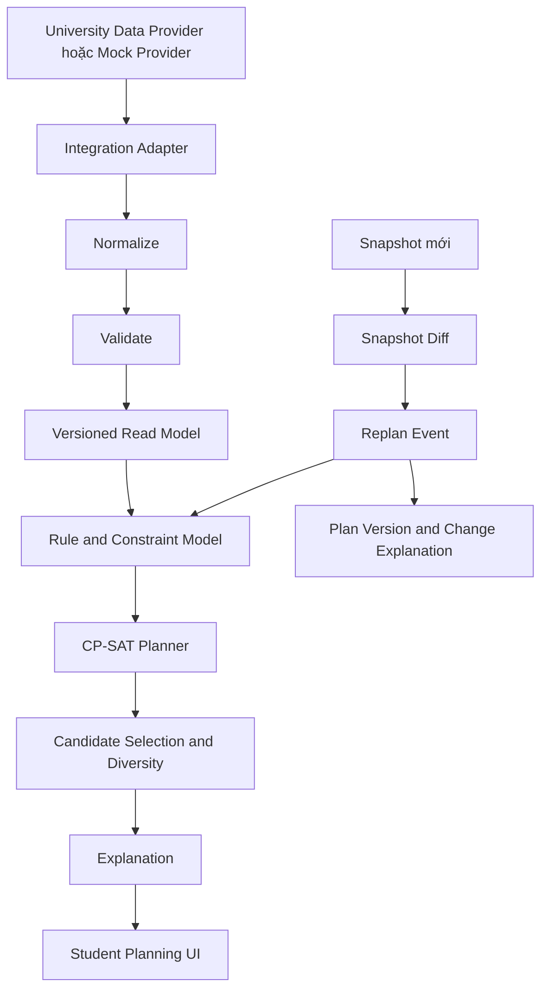

# Product: Những vấn đề đã xác định và cần tiếp tục xác định

**Ngày cập nhật:** 2026-10-28  
**Trạng thái:** Decision register trước khi thiết kế lại prototype  
**Phạm vi:** Hệ thống lập và cập nhật lộ trình học cho một chương trình đào tạo

> Khi nội dung tài liệu này khác với tài liệu prototype ngày 2026-10-22, tài liệu này phản ánh quyết định mới hơn. Tài liệu cũ vẫn hữu ích như lịch sử thiết kế nhưng cần được cập nhật trước khi dùng làm đặc tả triển khai.

## 1. Mục tiêu product đã xác định

Hệ thống là một **academic planning and replanning service**. Nó nhận các snapshot dữ liệu chỉ đọc do trường cung cấp, sinh nhiều lộ trình từ trạng thái hiện tại của sinh viên đến khi hoàn thành chương trình, giải thích kết quả và cập nhật phần tương lai khi dữ liệu thay đổi.

Hệ thống không phải là hệ thống đăng ký môn, không thực hiện transaction đăng ký và không cần biết kiến trúc nội bộ của các hệ thống hiện có trong trường.

Giá trị cốt lõi của product:

1. Không cần một planning guide có sẵn để sinh path.
2. Sinh nhiều hơn một lộ trình hợp lệ thay vì cung cấp một đường mẫu cố định.
3. Cho sinh viên thử lựa chọn khác recommendation và xem ảnh hưởng đến các kỳ sau.
4. Replan khi trạng thái học tập, đăng ký hiện tại hoặc thông tin mở môn thay đổi.
5. Giải thích recommendation và thay đổi bằng các luật đã được mã hóa.

## 2. Người dùng và ranh giới hệ thống đã xác định

### 2.1 Người dùng chính

- Sinh viên xem full degree path, gợi ý kỳ tiếp theo, thử phương án khác và xem replan.
- Cố vấn học tập có thể xem path, cảnh báo và lời giải thích để hỗ trợ tư vấn.

### 2.2 Nguồn dữ liệu bên ngoài

Product chỉ phụ thuộc vào một abstraction chung:

```text
UniversityDataProvider
├── getCurriculumSnapshot(programId, version)
├── getStudentAcademicSnapshot(studentId)
├── getCurrentEnrollmentSnapshot(studentId, termId)
└── getCourseOfferingSnapshot(termId, optionalPublicationStage)
```

Không giả định dữ liệu này đến trực tiếp từ SIS, hệ thống đăng ký, data warehouse hay một API cụ thể. Cơ chế nội bộ của trường nằm ngoài phạm vi đề tài.

### 2.3 Dữ liệu product được phép ghi

- Candidate paths.
- Active plan do sinh viên chọn.
- Plan versions.
- What-if selections.
- Student planning preferences.
- Assumptions, explanations và replan diffs.
- Sync metadata và data-quality results.

Product không sửa:

- Curriculum chính thức.
- Điểm và trạng thái pass/fail.
- Kết quả đăng ký chính thức.
- Trạng thái mở môn chính thức.

## 3. Luồng end-to-end đã xác định



### 3.1 Initial planning

1. Đọc curriculum, student academic state, current enrollment và offering snapshot mới nhất.
2. Chuẩn hóa và validate dữ liệu.
3. Khóa môn đã pass và giữ vị trí của môn đang enrolled trong kỳ hiện tại. Môn enrolled chưa được coi là đã hoàn thành để thỏa tiên quyết, trừ khi một rule đã được xác nhận cho phép đăng ký có điều kiện.
4. Sinh full paths cho các kỳ còn lại trong horizon chuẩn tám kỳ.
5. Chọn tối đa khoảng 3–5 path khác biệt có ý nghĩa.
6. Trả về path, assumptions, metrics và explanation.

### 3.2 What-if

Sinh viên có thể thử một tập môn khác recommendation. Đây là dữ liệu `selected` hoặc `self-reported`, chưa phải dữ liệu đăng ký chính thức. Hệ thống kiểm tra lựa chọn và replan các kỳ tương lai dựa trên giả định sinh viên giữ lựa chọn đó.

### 3.3 Replanning

Product lấy snapshot mới và so sánh với snapshot cũ để suy ra event, ví dụ:

- `in_progress → passed`: môn đã hoàn thành.
- `in_progress → failed`: môn không đạt.
- `not_enrolled → enrolled`: đăng ký đã được ghi nhận.
- `unknown → not_offered`: môn không được mở.
- `planned_open → cancelled`: lớp hoặc môn bị hủy.

Khi replan, product giữ nguyên các dữ kiện đã xảy ra, tối ưu phần tương lai và lưu path mới thành một version riêng thay vì ghi đè path cũ.

## 4. Phạm vi chức năng đã xác định

### 4.1 Trong scope

- Một chương trình đào tạo cụ thể.
- Hai học kỳ chính mỗi năm, horizon chuẩn tám kỳ, không có kỳ hè trong prototype.
- Full degree paths từ trạng thái hiện tại đến hết kỳ 8 tính từ khi sinh viên bắt đầu chương trình. Nếu kỳ 8 không còn khả thi, một solve riêng tìm kỳ hoàn thành sớm nhất.
- Required courses, elective groups, credit thresholds và graduation conditions.
- Tiên quyết, học trước, song hành và quan hệ khuyến nghị sau khi semantics được xác nhận.
- Per-term credit limits.
- Student state: passed, failed, in progress, enrolled và plan-assigned.
- Offering state theo snapshot version hoặc publication stage; registration round chỉ là metadata optional khi nguồn có cung cấp.
- Top-k representative paths, không enumerate toàn bộ nghiệm.
- What-if và stability-aware replanning.
- Eligibility, violation, path-selection và replan explanations.
- Mock University Data Provider khi chưa có API thật.
- Hai mock profiles khoảng 20–30 tín chỉ và 80–90 tín chỉ.

### 4.2 Ngoài scope hiện tại

- Gửi lệnh đăng ký môn.
- Thay thế hệ thống đăng ký của trường.
- Xếp lớp, phòng, giảng viên hoặc thời khóa biểu toàn trường.
- Dự đoán điểm, khả năng đậu hoặc độ khó bằng ML khi chưa có dữ liệu.
- Tự động hiểu hoàn toàn curriculum từ PDF mà không có bước xác nhận.
- Tối ưu đồng thời cho toàn bộ sinh viên.
- Production event bus hoặc tích hợp API thật khi chưa có quyền truy cập.
- Nhiều chương trình đào tạo trong prototype đầu tiên.

## 5. Dữ liệu và trạng thái đã xác định

### 5.1 Snapshot đầu vào

| Snapshot | Nội dung tối thiểu | Nguồn trong prototype |
|---|---|---|
| Curriculum | course, credits, groups, relations, policies, version | Dữ liệu chuẩn hóa từ tài liệu chính thức |
| Student academic | passed, failed, in-progress, accumulated credits | Mock profiles có cấu trúc hợp lệ |
| Current enrollment | môn đang enrolled hoặc trạng thái hiện tại | Mock snapshot |
| Course offering | term, snapshot version, optional publication stage, unknown/planned/confirmed/cancelled | Mock snapshot theo kịch bản |

### 5.2 Trạng thái cần phân biệt trên UI

| Trạng thái | Ý nghĩa | Nguồn sở hữu |
|---|---|---|
| `passed` | Đã hoàn thành | Trường |
| `failed` | Không hoàn thành | Trường |
| `in_progress` | Đang học | Trường |
| `recommended` | Solver đề xuất | Product |
| `plan_assigned` | Course đã được gán vào một future plan version | Product |
| `selected` | Sinh viên đang thử | Product |
| `self_reported` | Sinh viên tự khai nhưng chưa được xác nhận | Product |
| `enrolled` | Trạng thái hiện tại do snapshot trường cung cấp | Trường |
| `cancelled`/`not_offered` | Không còn khả dụng trong kỳ | Trường |

### 5.3 Data validation

Validation là bắt buộc dù product chỉ đọc dữ liệu:

- Schema validation.
- Referential integrity giữa course, group và relation.
- Curriculum reconciliation với tổng tín chỉ tốt nghiệp.
- Phát hiện prerequisite cycle hoặc rule không thể thỏa.
- Student-state consistency.
- Snapshot version, source và freshness.
- Phân loại `valid`, `warning`, `blocking`, `stale`, `unmatched`.

Lỗi nguồn không được sửa âm thầm trong product. Product báo lỗi và chờ snapshot đã được sửa từ nguồn có thẩm quyền.

## 6. Mô hình lập kế hoạch đã xác định ở mức khái niệm

### 6.1 Hard constraints dự kiến

- Hoàn thành mọi môn bắt buộc.
- Đủ tổng tín chỉ và threshold của từng requirement group.
- Không double-count course vào các nhóm loại trừ nhau.
- Không học lại môn đã pass nếu không có repeat rule.
- Tuân thủ prerequisite, previous-course và corequisite semantics.
- Không vượt giới hạn tín chỉ theo kỳ.
- Khóa completed facts; giữ enrolled course ở kỳ hiện tại nhưng không mặc định xem là đã pass; giữ accepted planning decisions theo policy replanning.
- Loại course bị `cancelled` hoặc `not_offered` trong kỳ tương ứng.
- Đáp ứng graduation conditions được biểu diễn trong dữ liệu.

### 6.2 Soft objectives dự kiến

Thứ tự ưu tiên khái niệm, chưa chốt toàn bộ trọng số:

1. Giảm trễ sau horizon chuẩn.
2. Giữ các quyết định hiện tại và active plan khi replan.
3. Giảm collateral changes.
4. Cân bằng tín chỉ giữa các kỳ.
5. Đưa các môn mở khóa nhiều môn khác lên sớm.
6. Thỏa elective interests khi có dữ liệu preference.
7. Dùng course code làm deterministic tie-break cuối cùng.

Course-code ordering không có ý nghĩa học thuật và không được dùng làm explanation về chất lượng path.

### 6.3 Top-k paths

- Không hiển thị toàn bộ nghiệm khả thi.
- Dùng diversity constraint hoặc clustering để tránh các path gần như giống nhau.
- Mỗi path hiển thị phải khác biệt có ý nghĩa về elective set, term assignment, load hoặc completion outcome.
- Nếu không có đủ path khác biệt, trả về ít hơn top-k và giải thích.

## 7. Explanation đã xác định ở mức chức năng

Product cần trả lời được:

- Vì sao môn này đủ hoặc chưa đủ điều kiện?
- Môn đóng góp vào requirement group nào?
- Môn mở khóa những môn nào?
- Vì sao môn được xếp trong kỳ này?
- Vì sao một lựa chọn của sinh viên làm path không hợp lệ?
- Vì sao môn bị đổi kỳ sau khi replan?
- Có còn hoàn thành trong tám kỳ không?
- Nếu không còn path đúng hạn, ràng buộc nào gây ra và relaxation gần nhất là gì?

Explanation phải lấy từ rule/constraint trace và structured solver output; LLM, nếu có, chỉ diễn đạt lại chứ không tạo ra sự thật học vụ.

## 8. Những vấn đề product cần tiếp tục xác định

### 8.1 Luật học vụ cần nguồn có thẩm quyền xác nhận

- Semantics chính xác của `TQ`, `HT`, `SH`, `KN`.
- `KN` là hard precedence hay soft preference trong product chính.
- AND/OR semantics của prerequisite phức hợp.
- Điều kiện pass tối thiểu cho từng loại relation.
- In-progress course có cho phép sử dụng có điều kiện khi đăng ký môn sau hay không.
- Min/max credits và ngoại lệ theo tình trạng học vụ.
- Cách tính môn học lại, môn tương đương và tín chỉ chuyển đổi.
- Điều kiện đồ án, thực tập, ngoại ngữ và các điều kiện zero-credit.
- Cách phân bổ course khi một môn có thể thỏa nhiều requirement group.
- Đối soát chính xác tổng 128 tín chỉ từ curriculum chính thức.

### 8.2 Data contract thực tế

- Trường có thể cung cấp chính xác những snapshot nào.
- Field nào tồn tại và field nào chỉ là giả định của mock contract.
- Có curriculum version và effective date hay không.
- Có lấy được current enrollment không hay chỉ có transcript sau khi hoàn thành kỳ.
- Có offering publication stage hoặc registration-round metadata không.
- Có timestamp, source version và change history không.
- Cách nhận diện transfer/equivalent/unmatched courses.
- Tần suất refresh hợp lý và cách phát hiện dữ liệu stale.
- Quyền truy cập, ẩn danh hóa và dữ liệu tối thiểu product cần đọc.

### 8.3 Hành vi planning và replanning

- Horizon chuẩn luôn dừng ở kỳ 8 hay cho phép chạy riêng earliest-feasible extension.
- Kỳ đầu do trường sắp có cần khóa hoàn toàn trong mọi profile không.
- Cách xử lý optimistic/conservative branch cho môn đang học.
- Quyết định nào của sinh viên được coi là lock.
- Khi offering còn `unknown`, course được phép xuất hiện với nhãn nào.
- Stability objective được ưu tiên trước hay sau load balance.
- Ngưỡng path diversity và số path tối đa cuối cùng.
- Định nghĩa collateral change trong product UI.
- Cách chọn representative khi nhiều path đồng hạng.

### 8.4 UX và explanation

- Product là trang riêng hay module trong hệ sinh thái trường; không cần chốt nơi đặt vật lý trước khi chốt flow.
- Cách phân biệt official facts, assumptions, recommendations và what-if selections bằng nhãn/màu.
- Có cần thao tác “accept active plan” hay chỉ lưu path gần nhất.
- Mức chi tiết explanation phù hợp với sinh viên và cố vấn.
- Khi infeasible, nên hiển thị earliest completion, minimum repair hay cả hai.
- Cách trình bày offering uncertainty giữa đợt 1, 2 và 3.
- Có cần Data Health page cho prototype hay chỉ cần developer simulator.

### 8.5 Mock và integration

- OpenAPI/JSON Schema cụ thể cho Mock University Data Provider.
- Bộ snapshot version dùng trong demo.
- Cách mô phỏng grade update, enrollment update và offering update.
- Adapter boundary trong codebase hiện tại.
- Contract tests để bảo đảm mock và real adapter sau này trả cùng canonical model.
- Cơ chế refresh trong prototype: tải trang, nút refresh hay polling.

## 9. Những câu cần hỏi thầy về product

1. Thầy có đồng ý scope là planning/replanning decision support, không thực hiện đăng ký chính thức không?
2. Thầy có xác nhận planning guide chỉ là tài liệu tham khảo/baseline và không phải input bắt buộc của phương pháp đề xuất không?
3. Hệ thống có được giả định nhận read-only snapshots từ trường và dùng mock provider trong prototype không?
4. Nguồn nào được xem là authoritative để xác nhận curriculum rules?
5. Ai có thể kiểm tra semantics TQ/HT/SH/KN và một số sample paths?
6. Scope một chương trình đào tạo và hai mock students có đủ cho product prototype không?
7. Thầy mong explanation tập trung vào eligibility/violation hay cả lý do chọn path và replan?

## 10. Điều kiện để bắt đầu rebuild prototype

Trước khi thay đổi product code, cần tối thiểu:

- Chốt system boundary và canonical snapshot model.
- Đối soát curriculum 128 tín chỉ.
- Chốt semantics của các course relations cốt lõi.
- Có một mock-provider contract version đầu tiên.
- Có một demo story end-to-end với snapshot v1 → event → snapshot v2 → replan.
- Chốt những màn hình cần giữ, bỏ và xây lại.
- Ghi rõ những giả định chưa được trường xác nhận trong UI và tài liệu.

## 11. Definition of clarity

Một người mới đọc tài liệu hoặc xem demo phải trả lời được:

1. Dữ liệu nào đến từ trường và dữ liệu nào do product tạo.
2. Product quyết định điều gì và không quyết định điều gì.
3. Một path khác gì kết quả đăng ký hoặc trạng thái học tập chính thức.
4. Khi nào replan xảy ra và phần nào được phép thay đổi.
5. Vì sao một path hoặc một course recommendation được đưa ra.
6. Mock API đang thay thế phần integration nào chưa có thật.

