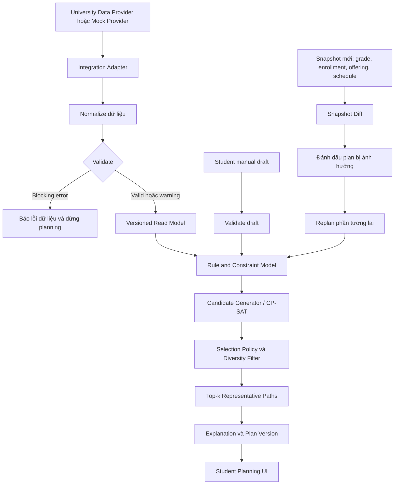
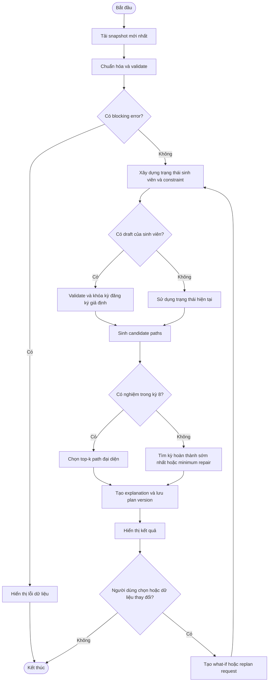
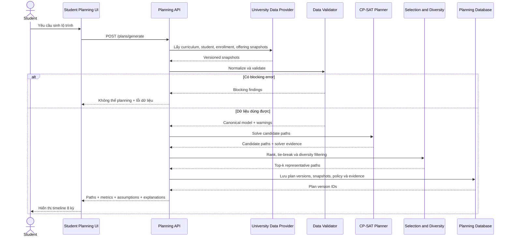
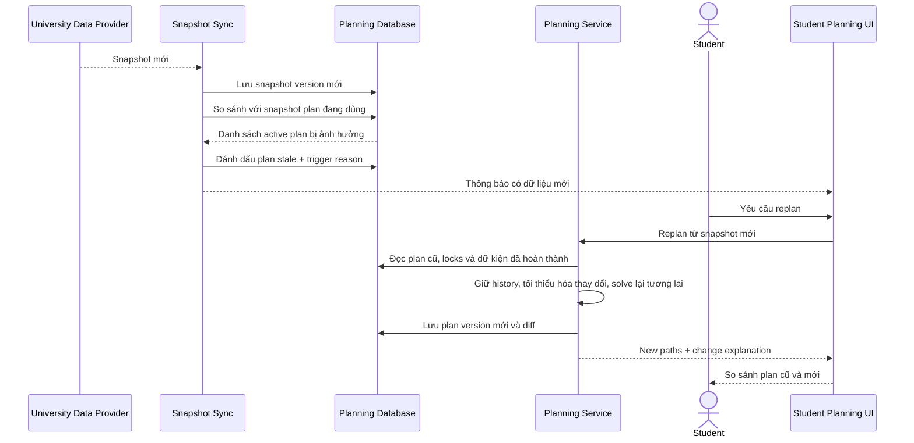

# Gói xác nhận phạm vi và thiết kế hệ thống v0.1

**Mục đích:** dùng để nhóm thống nhất nội bộ và xin giảng viên xác nhận trước khi hoàn thiện Functional Requirements, Non-functional Requirements, Use Case Specification và các sơ đồ chi tiết.

**Trạng thái:** bản nháp để xác nhận. Các nội dung được đánh dấu **Cần thầy xác nhận** chưa được xem là quyết định cuối cùng.

## 1. Phát biểu bài toán

Sinh viên hiện phải tham khảo kế hoạch giảng dạy mẫu và tự lựa chọn môn cho từng học kỳ. Một lựa chọn có thể hợp lệ ở kỳ hiện tại nhưng làm chậm tiến độ hoặc khóa các lựa chọn ở các kỳ sau.

Hệ thống được đề xuất là một dịch vụ hỗ trợ lập và cập nhật lộ trình học tập. Hệ thống nhận chương trình đào tạo, tiến độ học tập, đăng ký hiện tại và thông tin mở môn; sau đó sinh một số lộ trình hợp lệ đến khi hoàn thành chương trình, giải thích kết quả và lập lại phần tương lai khi dữ liệu thay đổi.

Giá trị chính của hệ thống:

1. Sinh lộ trình mà không cần kế hoạch giảng dạy thủ công làm input.
2. Cung cấp nhiều hơn một lộ trình đại diện thay vì một đường mẫu cố định.
3. Cho phép sinh viên đăng ký hoặc thử lựa chọn khác recommendation và xem ảnh hưởng đến các kỳ sau.
4. Lập lại lộ trình khi sinh viên rớt môn, đăng ký khác kế hoạch, môn không mở hoặc lịch học xung đột.
5. Giải thích kết quả bằng dữ kiện, luật và output có cấu trúc của solver.

## 2. Phạm vi prototype đề xuất

### Trong phạm vi

- Một chương trình đào tạo cụ thể.
- Hai học kỳ chính mỗi năm; timeline chuẩn tám học kỳ; không giả định có kỳ hè.
- Dữ liệu chương trình đào tạo, tiến độ sinh viên, đăng ký hiện tại, mở môn và lịch nhóm lớp dưới dạng snapshot.
- Mock University Data Provider khi chưa có API thật của trường.
- Phân tích điều kiện học và yêu cầu tốt nghiệp còn thiếu.
- Sinh tối đa khoảng 3–5 lộ trình đại diện.
- Sinh viên chọn active plan hoặc tự tạo draft cho kỳ tiếp theo.
- What-if và replanning cho các kỳ tương lai.
- Giải thích eligibility, path selection, thay đổi khi replan và trường hợp không có nghiệm.
- Lưu phiên bản lộ trình và so sánh giữa hai phiên bản.

### Ngoài phạm vi

- Gửi lệnh đăng ký hoặc hủy môn đến hệ thống đăng ký chính thức.
- Thay thế hệ thống đăng ký môn hiện tại của trường.
- Xếp lớp, phòng, giảng viên hoặc thời khóa biểu cho toàn trường.
- Dự đoán điểm, độ khó hoặc khả năng qua môn khi chưa có dataset phù hợp.
- Tối ưu đồng thời cho toàn bộ sinh viên.
- Dùng kế hoạch giảng dạy hoặc học kỳ khuyến nghị làm input bắt buộc để sinh path.

## 3. Actors và hệ thống bên ngoài

| Actor / Hệ thống | Trách nhiệm trong prototype |
|---|---|
| Sinh viên | Xem tiến độ, yêu cầu sinh path, chọn active plan, tạo draft kỳ tới, chạy what-if, yêu cầu replan và xem giải thích. |
| Admin / Data steward | Xem tình trạng dữ liệu; trong prototype có thể thay đổi dữ liệu mở môn giả lập để minh họa replanning. |
| Cố vấn học tập | **Cần thầy xác nhận:** chỉ xem lộ trình và chạy what-if không ràng buộc, hoặc để ngoài prototype. |
| University Data Provider | Cung cấp các snapshot chỉ đọc theo một data contract chung. Trong prototype actor này được thay bằng mock provider. |
| Planning Service | Chuẩn hóa dữ liệu, kiểm tra luật, gọi solver, chọn path đại diện, tạo explanation và replan. |
| Official Registration System | Hệ thống bên ngoài phạm vi; nguồn dữ liệu đăng ký hoặc lịch học nếu trường cung cấp, nhưng không nhận lệnh đăng ký từ sản phẩm. |

## 4. Giả định tích hợp

1. Prototype chưa cần kết nối API thật của trường.
2. Nhóm định nghĩa một `UniversityDataProvider` abstraction và triển khai mock provider theo cùng contract.
3. Dữ liệu từ trường là read-only; hệ thống chỉ ghi candidate path, active plan, plan version, preference, assumption và explanation của riêng sản phẩm.
4. Mỗi snapshot có `source`, `version`, `retrievedAt` và trạng thái freshness.
5. Khi snapshot mới xuất hiện, hệ thống so sánh với phiên bản cũ, đánh dấu plan bị ảnh hưởng và cho phép replan.
6. Nếu chưa có dữ liệu mở môn của kỳ tương lai, path chỉ được ghi là khả thi theo giả định, không được trình bày như chắc chắn sẽ mở.
7. Nếu chưa có lịch nhóm lớp, hệ thống chưa kiểm tra được xung đột lịch; khi lịch có sẵn, hệ thống nhận dữ liệu để cảnh báo hoặc replan nhưng không tự xếp thời khóa biểu cho trường.

## 5. Luồng đầu cuối đề xuất

## 6. Use case cốt lõi

| ID | Use case | Actor chính | Kết quả thành công |
|---|---|---|---|
| UC-01 | Xem tiến độ và yêu cầu còn thiếu | Sinh viên | Hệ thống hiển thị trạng thái học tập, tín chỉ và các requirement chưa hoàn thành. |
| UC-02 | Sinh các lộ trình học đầy đủ | Sinh viên | Hệ thống trả tối đa top-k path hợp lệ cùng metric, assumption và explanation. |
| UC-03 | Chọn active plan | Sinh viên | Một plan version được chọn làm active nhưng không trở thành đăng ký chính thức. |
| UC-04 | Tạo lựa chọn kỳ tới khác recommendation | Sinh viên | Draft được validate; các lỗi, cảnh báo và giả định được hiển thị. |
| UC-05 | Replan từ lựa chọn của sinh viên | Sinh viên | Kỳ đang chọn được khóa như assumption; các kỳ sau được sinh lại. |
| UC-06 | Cập nhật sau thay đổi dữ liệu trường | Sinh viên / Hệ thống | Plan bị ảnh hưởng được đánh dấu stale và có thể được replan từ snapshot mới. |
| UC-07 | Xem giải thích | Sinh viên | Người dùng biết vì sao môn/path được chọn, bị loại hoặc bị đổi kỳ. |
| UC-08 | So sánh các phiên bản lộ trình | Sinh viên | Hệ thống hiển thị những môn, học kỳ và outcome đã thay đổi. |
| UC-09 | Mô phỏng thay đổi mở môn | Admin | Dữ liệu giả lập thay đổi và hệ thống phát hiện các plan bị ảnh hưởng. |

## 7. Activity diagram tổng quát

## 8. Sequence diagram: sinh lộ trình lần đầu

## 9. Sequence diagram: snapshot mới và replanning

## 10. Non-functional requirements cần đặc tả

Các NFR sau cần được viết thành tiêu chí đo được sau khi thầy xác nhận phạm vi:

| Nhóm | Nội dung cần chốt |
|---|---|
| Correctness | Mọi path được công bố là hợp lệ phải thỏa toàn bộ hard constraint đã mã hóa. |
| Performance | Thời gian phản hồi mục tiêu cho eligibility, initial planning và replanning với dữ liệu prototype. |
| Explainability | Mọi kết luận chính phải truy ngược được đến rule, constraint, policy hoặc source snapshot. |
| Security và privacy | Xác thực, phân quyền, ownership, dữ liệu tối thiểu và audit truy cập. |
| Reliability | Cách xử lý solver timeout, provider unavailable và dữ liệu stale. |
| Data quality | Blocking/warning rules, provenance, version và freshness. |
| Maintainability | Luật, policy và data adapter được tách khỏi UI và solver implementation. |
| Reproducibility | Cùng input snapshot, policy version và solver configuration phải tạo kết quả có thể tái lập. |
| Usability | Sinh viên phân biệt được official fact, recommendation, assumption và what-if selection. |

## 11. Những điểm cần thầy xác nhận

1. Thầy có đồng ý phạm vi là hệ thống hỗ trợ planning/replanning, không thực hiện đăng ký môn chính thức không?
2. Thầy có đồng ý hệ thống sinh path từ chương trình đào tạo và trạng thái sinh viên, còn kế hoạch giảng dạy chỉ là baseline đánh giá không?
3. Trong prototype, nhóm có được dùng mock provider với contract giả lập thay cho API thật của trường không?
4. Có cần đưa vai trò Cố vấn học tập vào prototype hay chỉ tập trung vào Sinh viên và Admin mô phỏng dữ liệu?
5. Với môn đang học, nhóm có được tạo nhánh planning giả định sinh viên sẽ đạt, gắn nhãn rõ và replan khi có điểm thật không?
6. Quan hệ `KN` trong chương trình đào tạo nên là hard precedence hay soft preference trong phạm vi đề tài?
7. Khi không thể hoàn thành trong tám kỳ, output nên gồm kỳ hoàn thành sớm nhất, minimum repair hay cả hai?
8. Thầy có chấp nhận các tiêu chí đánh giá ban đầu gồm validity, solve time, path diversity, completion outcome, replan stability và explanation correctness không?

## 12. Tiêu chí để nhóm biết sơ đồ đã nhất quán

Mỗi sơ đồ hoặc use case phải vượt qua các kiểm tra sau:

- Dùng cùng actor và cùng tên component với tài liệu này.
- Mỗi bước quan trọng ánh xạ được đến ít nhất một FR.
- Không có bước ghi dữ liệu ngược về hệ thống chính thức của trường.
- Dữ liệu giả lập, giả định và dữ kiện chính thức được phân biệt.
- Luồng lỗi dữ liệu, không có nghiệm và solver timeout được thể hiện bằng alternative flow phù hợp.
- Activity diagram mô tả nghiệp vụ; sequence diagram mô tả component trao đổi để thực hiện cùng nghiệp vụ đó.
- Input và output trong use case trùng với message trong sequence diagram.
- Replanning giữ lịch sử đã xảy ra và chỉ tối ưu phần tương lai.

## 13. Thứ tự công việc sau khi thầy xác nhận

1. Chốt scope baseline và assumption register.
2. Rút 57 FR hiện tại thành danh sách `Must / Should / Future` cho prototype.
3. Viết NFR có metric và điều kiện kiểm thử cụ thể.
4. Hoàn thiện Use Case Diagram và đặc tả chi tiết UC-01 đến UC-09.
5. Hoàn thiện activity diagram cho initial planning và replanning.
6. Hoàn thiện sequence diagram cho bốn luồng: load data, generate paths, what-if và replan.
7. Đồng bộ component diagram, deployment diagram và data model với các sequence đã chốt.
8. Lập traceability matrix `Goal -> Use case -> FR/NFR -> Diagram -> Test/Evaluation`.
9. Khóa baseline thiết kế trước khi tiếp tục mở rộng prototype.
10. Từ baseline sản phẩm, chốt research questions, baseline nghiên cứu, dataset/simulation và evaluation metrics cho bài báo.

## 14. Mẫu tin nhắn xin thầy review

> Thưa thầy, sau khi rà soát lại đề tài, nhóm em điều chỉnh trọng tâm thành hệ thống hỗ trợ lập và cập nhật nhiều lộ trình học từ chương trình đào tạo và tiến độ sinh viên. Hệ thống không thực hiện đăng ký môn chính thức và không cần kế hoạch giảng dạy thủ công làm input. Do nhóm chưa có API thật của trường, prototype dự kiến dùng một mock data provider có cùng contract với nguồn dữ liệu giả định của trường.
>
> Nhóm em đã chuẩn bị một bản Scope Validation v0.1 gồm phạm vi, giả định tích hợp, use case cốt lõi và các sơ đồ đầu cuối nháp. Nhóm mong thầy xác nhận giúp các điểm ảnh hưởng lớn đến thiết kế: ranh giới với hệ thống đăng ký, việc dùng mock provider, cách xử lý môn đang học và quan hệ KN, vai trò cố vấn học tập, cùng output khi không thể hoàn thành trong tám kỳ.
>
> Sau khi nhận xác nhận của thầy, nhóm em sẽ khóa scope và đồng bộ Functional Requirements, Non-functional Requirements, Use Case Specification cùng các diagram theo cùng baseline. Nhóm xin phép gửi thầy tài liệu kèm theo và mong có một buổi trao đổi ngắn để tránh tiếp tục triển khai sai hướng.

