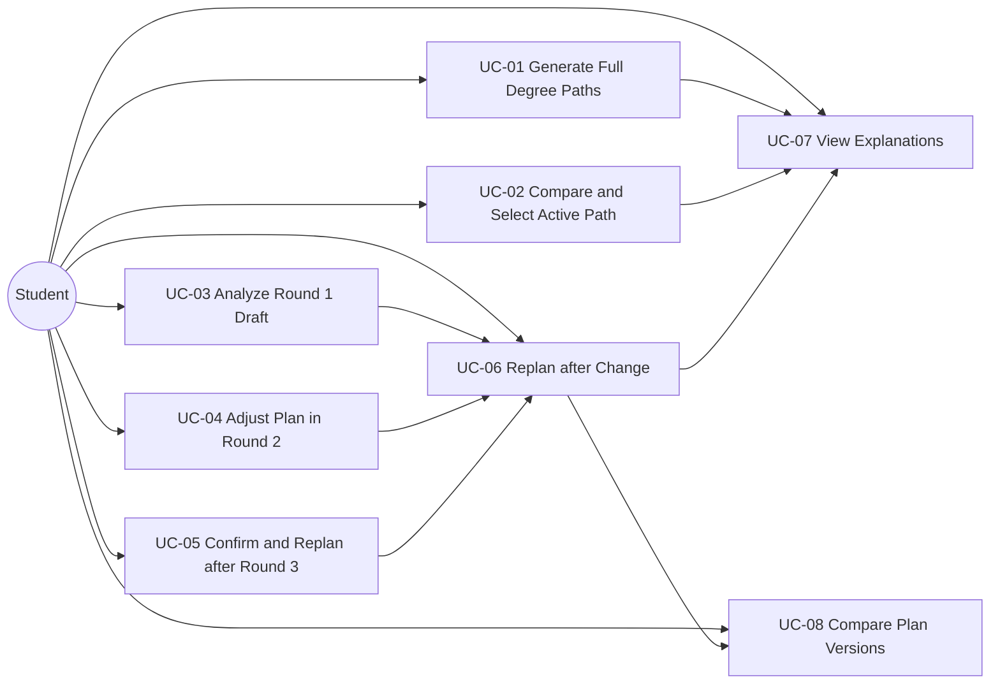

# Đặc tả Use Case — Degree Path Planning and Replanning Module

**Phiên bản:** 0.1  
**Nguồn yêu cầu:** `functional-requirements-integrated-degree-planner-vi.md`  
**Trạng thái:** Đã xác định use case inventory; UC-01 được đặc tả chi tiết đầu tiên

## 1. Actors

| Actor | Loại | Trách nhiệm trong use case |
|---|---|---|
| Student | Primary | Khởi tạo planning, xem và lựa chọn path, phân tích registration draft, yêu cầu replan và xem explanation/history. |
| Existing University Portal / Course Registration System | External system | Cung cấp student context, registration round, registration draft và registration result; hiển thị kết quả của module trong bối cảnh tích hợp. |
| University Data Provider | Supporting | Cung cấp curriculum, academic snapshot, eligibility, course offering, section, capacity và timetable dưới dạng chỉ đọc. |

Trong prototype, `Mock University Data Provider` thay thế University Data Provider nhưng không tạo thành một business use case riêng.

## 2. Use Case Inventory

| ID | Use case | Primary actor | Mục tiêu | FR liên quan |
|---|---|---|---|---|
| UC-01 | Generate Full Degree Paths | Student | Sinh các lộ trình từ trạng thái hiện tại đến khi hoàn thành chương trình. | FR-1, FR-2, FR-3, FR-4 |
| UC-02 | Compare and Select Active Path | Student | So sánh representative paths và chọn một active plan. | FR-4, FR-5.2–FR-5.10, FR-9 |
| UC-03 | Analyze Round 1 Registration Draft | Student | Phân tích lựa chọn đăng ký Đợt 1 và xem ảnh hưởng đến các kỳ sau. | FR-5.11–FR-5.21, FR-8, FR-9 |
| UC-04 | Adjust Plan in Registration Round 2 | Student | Xử lý môn bị loại, không mở, đầy hoặc trùng lịch và nhận phương án thay thế. | FR-6, FR-8, FR-9 |
| UC-05 | Confirm and Replan after Registration Round 3 | Student | Cập nhật path từ kết quả đăng ký cuối cùng của kỳ tiếp theo. | FR-7, FR-8, FR-9 |
| UC-06 | Replan after Academic or Registration Change | Student | Lập lại phần tương lai khi academic snapshot hoặc dữ liệu đăng ký thay đổi. | FR-1.15, FR-2.12, FR-8, FR-9 |
| UC-07 | View Recommendation Explanations | Student | Xem lý do môn/path được chọn, bị loại, thay thế hoặc chuyển kỳ. | FR-4.16, FR-5.4–FR-5.8, FR-9.1–FR-9.10 |
| UC-08 | Review and Compare Plan Versions | Student | Xem active version, lịch sử và khác biệt giữa các phiên bản. | FR-6.19, FR-7.12, FR-8.12–FR-8.13, FR-9.11–FR-9.15 |

## 3. Quan hệ giữa các use case

Sơ đồ trên mô tả dependency nghiệp vụ ở mức khái quát. Khi vẽ UML Use Case Diagram chính thức, các quan hệ phải được đổi thành `<<include>>` hoặc `<<extend>>` chỉ khi semantics tương ứng được xác nhận trong từng đặc tả chi tiết.

## 4. UC-01 — Generate Full Degree Paths

### 4.1. Thông tin chung

| Trường | Nội dung |
|---|---|
| Use Case ID | UC-01 |
| Use Case Name | Generate Full Degree Paths |
| Scope | Degree Path Planning and Replanning Module |
| Level | User goal |
| Primary Actor | Student |
| Supporting Actors | Existing University Portal, University Data Provider |
| Goal | Sinh các representative path từ trạng thái học tập hiện tại đến khi hoàn thành curriculum. |
| Trigger | Sinh viên mở chức năng lập lộ trình và yêu cầu sinh path. |

### 4.2. Preconditions

1. Sinh viên đã được Existing University Portal xác thực.
2. Module nhận được student identifier và target registration semester.
3. University Data Provider có Student Academic Snapshot và curriculum version áp dụng cho sinh viên.
4. Curriculum đã được chuẩn hóa thành các course, requirement group và academic rule mà planner hỗ trợ.

### 4.3. Success postconditions

1. Hệ thống tạo được một hoặc nhiều representative path hợp lệ hoặc hợp lệ theo các assumption được công bố.
2. Mỗi path được liên kết với input snapshot versions, constraint model version và selection policy version.
3. Sinh viên xem được timeline, metric, assumption, warning và explanation của từng path.
4. Kết quả được lưu thành các plan version nhưng chưa tự động trở thành active plan.

### 4.4. Minimal guarantee

Nếu không thể sinh path, hệ thống không thay đổi active plan hiện tại và phải trả về trạng thái thất bại cùng nguyên nhân như thiếu dữ liệu, infeasible hoặc solver timeout.

### 4.5. Main success scenario

1. Sinh viên yêu cầu sinh degree paths.
2. Module nhận student context và target registration semester từ Existing University Portal.
3. Module yêu cầu curriculum, Student Academic Snapshot và dữ liệu đăng ký mới nhất từ University Data Provider.
4. University Data Provider trả về các versioned snapshots hiện có.
5. Module kiểm tra tính đầy đủ và nhất quán của dữ liệu.
6. Module khóa các kỳ đã hoàn thành và giữ các môn đang học hoặc đã đăng ký theo snapshot.
7. Module xây dựng constraint model cho phần timeline tương lai.
8. Planner sinh các candidate path thỏa hard constraints.
9. Module áp dụng selection policy, diversity criteria và deterministic tie-break.
10. Module chọn tối đa số representative path theo cấu hình.
11. Module tạo metric, assumption, warning và explanation evidence cho từng path.
12. Module lưu kết quả cùng input snapshot và model versions.
13. Hệ thống hiển thị các representative path cho sinh viên.

### 4.6. Alternative and exception flows

#### A1 — Dữ liệu chưa được công bố nhưng vẫn có thể planning

1. Ở bước 5, module phát hiện course offering hoặc timetable tương lai chưa được công bố.
2. Module tiếp tục planning bằng các assumption được policy cho phép.
3. Kết quả được đánh dấu `feasible_with_assumptions`.
4. Hệ thống hiển thị rõ dữ liệu nào chưa được xác nhận.

#### A2 — Dữ liệu có blocking error

1. Ở bước 5, module phát hiện curriculum không đối soát được, thiếu academic snapshot bắt buộc hoặc rule reference không hợp lệ.
2. Module dừng quá trình sinh path.
3. Hệ thống trả về lỗi dữ liệu và không công bố path mới.

#### A3 — Không có path hoàn thành trong kỳ 8

1. Ở bước 8, planner không tìm thấy candidate hoàn thành trước hết kỳ 8.
2. Module ghi nhận mục tiêu tám kỳ là infeasible.
3. Planner chạy một lần giải riêng để tìm học kỳ hoàn thành sớm nhất sau kỳ 8.
4. Nếu tìm thấy, hệ thống hiển thị phần mở rộng timeline cùng explanation.
5. Nếu không tìm thấy, use case chuyển sang A4.

#### A4 — Không có candidate path khả thi

1. Planner trả về `infeasible`.
2. Module xác định các constraint hoặc dữ kiện đã khóa liên quan khi evidence cho phép.
3. Hệ thống thông báo không có path khả thi và không thay đổi active plan.

#### A5 — Solver timeout

1. Planner không hoàn tất trong giới hạn cấu hình.
2. Module trả về trạng thái `solver_timeout`.
3. Nếu có incumbent path đã được chứng minh hợp lệ, hệ thống có thể hiển thị path đó kèm cảnh báo chưa hoàn tất tìm kiếm.
4. Nếu không có incumbent hợp lệ, hệ thống không hiển thị path mới.

#### A6 — University Data Provider unavailable

1. Ở bước 3, provider không phản hồi.
2. Module thông báo không thể lấy snapshot mới nhất.
3. Nếu cho phép xem plan cũ, hệ thống phải ghi rõ plan đó được sinh từ snapshot nào và có thể đã stale.
4. Module không được trình bày plan cũ như kết quả vừa được tính từ dữ liệu mới.

### 4.7. Inputs

- Authenticated student identifier.
- Target registration semester.
- Curriculum snapshot và curriculum version.
- Student Academic Snapshot.
- Current registration snapshot nếu có.
- Selection policy version.
- Solver configuration.

### 4.8. Outputs

- Tối đa top-k representative paths.
- Timeline từ kỳ bắt đầu đến kỳ hoàn thành.
- Metric và objective profile của từng path.
- Assumptions và warnings.
- Explanation evidence.
- Plan version identifiers.
- Trạng thái solve.

### 4.9. Related functional requirements

- FR-1.1–FR-1.15.
- FR-2.1–FR-2.12.
- FR-3.1–FR-3.18.
- FR-4.1–FR-4.17.
- FR-9.1–FR-9.4.
- FR-9.9–FR-9.12.

