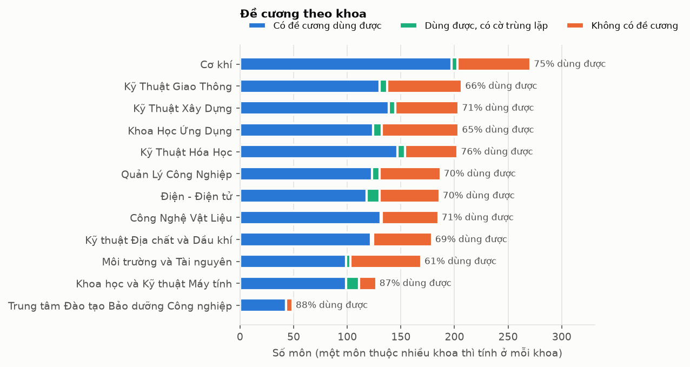
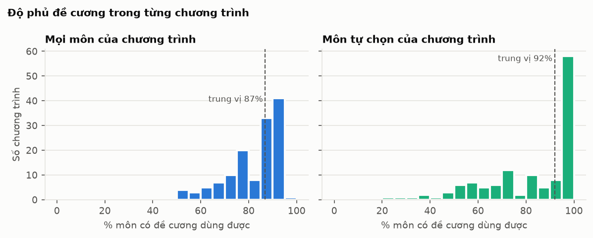
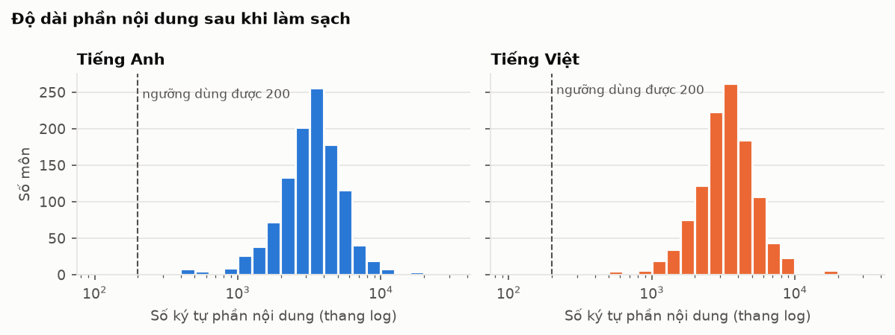
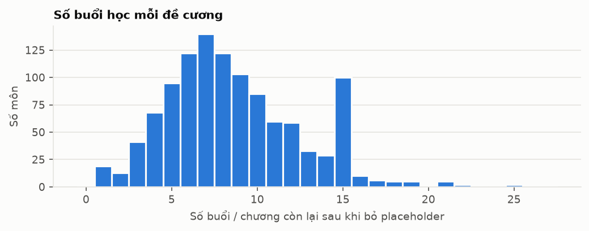
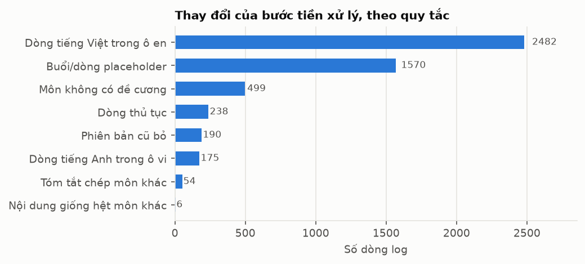

# Báo cáo dữ liệu sau bước 1 (trích + tiền xử lý)

Snapshot trích lúc 2026-11-20T19:05:33+00:00. Sinh bằng `python -m tag_classifier.eda`; mọi số trong file này tính lại từ `data/` mỗi lần chạy.

## 1. Tổng quan

|  | Số |
|---|---|
| Chương trình | 132 |
| Môn có trong ít nhất một chương trình | 1626 |
| Phiên bản đề cương / môn có đề cương | 1317 / 1127 |
| Môn có đề cương dùng được | 1127 (69%) |
| … đủ hai ngôn ngữ / chỉ tiếng Anh / chỉ tiếng Việt | 1126 / 0 / 1 |
| Môn không có đề cương | 499 |
| Môn có cờ `copied_summary` / `identical_content` | 54 / 6 |

Mọi môn có đề cương đều qua ngưỡng dùng được (200 ký tự phần nội dung). Thiếu dữ liệu nằm ở **môn không có đề cương**, không ở đề cương quá ngắn.

## 2. Đề cương theo khoa

| Khoa | Môn | Dùng được | …có cờ trùng | Không đề cương | Tỉ lệ dùng được |
|---|---|---|---|---|---|
| Cơ khí | 271 | 203 | 6 | 68 | 75% |
| Kỹ Thuật Giao Thông | 207 | 137 | 7 | 70 | 66% |
| Kỹ Thuật Xây Dựng | 204 | 145 | 6 | 59 | 71% |
| Khoa Học Ứng Dụng | 204 | 132 | 8 | 72 | 65% |
| Kỹ Thuật Hóa Học | 203 | 154 | 7 | 49 | 76% |
| Quản Lý Công Nghiệp | 187 | 130 | 7 | 57 | 70% |
| Điện - Điện tử | 186 | 130 | 12 | 56 | 70% |
| Công Nghệ Vật Liệu | 185 | 132 | 1 | 53 | 71% |
| Kỹ thuật Địa chất và Dầu khí | 179 | 124 | 2 | 55 | 69% |
| Môi trường và Tài nguyên | 169 | 103 | 4 | 66 | 61% |
| Khoa học và Kỹ thuật Máy tính | 127 | 111 | 12 | 16 | 87% |
| Trung tâm Đào tạo Bảo dưỡng Công nghiệp | 49 | 43 | 0 | 6 | 88% |

## 3. Độ phủ trong từng chương trình

Tag được xét trong từng chương trình, nên điều cần biết là mỗi chương trình có bao nhiêu môn có đề cương, nhất là môn tự chọn (tag chỉ ảnh hưởng môn tự chọn trong engine ASP).

| Phạm vi | Số chương trình | Nhỏ nhất | Q1 | Trung vị | Q3 | Lớn nhất |
|---|---|---|---|---|---|---|
| Mọi môn | 132 | 50% | 76% | 87% | 90% | 95% |
| Môn tự chọn | 128 | 24% | 68% | 92% | 100% | 100% |

Các chương trình có độ phủ thấp nhất:

| Chương trình | Khoa | Môn | Dùng được | Tự chọn dùng được |
|---|---|---|---|---|
| NE-2026-KTHN | Khoa Học Ứng Dụng | 66 | 50% | 10/20 |
| SCE-2026-KTBD | Công Nghệ Vật Liệu | 74 | 50% | 13/28 |
| GTE-2026-DKTXD | Kỹ thuật Địa chất và Dầu khí | 62 | 53% | 4/17 |
| RE-2026-KTDS | Kỹ Thuật Giao Thông | 89 | 54% | 22/44 |
| LSC-2026-LQLCCU | Quản Lý Công Nghiệp | 61 | 57% | 6/17 |
| FT-2026-CNTP | Kỹ Thuật Hóa Học | 66 | 58% | 5/17 |
| NRE-2026-KTTNTN | Môi trường và Tài nguyên | 80 | 59% | 20/36 |
| IMT-2026-BDCN | Cơ khí | 63 | 62% | 9/17 |

## 4. Độ dài và cấu trúc văn bản

| Ngôn ngữ | Môn có chữ | Nhỏ nhất | Q1 | Trung vị | Q3 | Lớn nhất |
|---|---|---|---|---|---|---|
| Tiếng Anh | 1127 | 52 | 2408 | 3322 | 4466 | 22158 |
| Tiếng Việt | 1127 | 430 | 2544 | 3376 | 4422 | 20119 |

Phần nội dung có trong đề cương, theo ngôn ngữ (1127 môn dùng được):

| Phần | Có tiếng Anh | Có tiếng Việt |
|---|---|---|
| summary | 1115 (99%) | 1122 (100%) |
| objectives | 1113 (99%) | 1127 (100%) |
| learning_outcomes | 1120 (99%) | 1127 (100%) |
| sessions | 1121 (99%) | 1126 (100%) |

| Không còn buổi nào | Q1 | Trung vị | Q3 | Nhiều nhất |
|---|---|---|---|---|
| 1 | 6 | 8 | 11 | 27 |

Đỉnh ở 15 buổi là mẫu đề cương 15 tuần; đề cương ít buổi thường gộp theo chương.

## 5. Tiền xử lý đã thay đổi gì

| Quy tắc | Nghĩa | Dòng log | Số môn |
|---|---|---|---|
| `en_is_vi` | Dòng tiếng Việt trong ô en | 2482 | 596 |
| `placeholder` | Buổi/dòng placeholder | 1570 | 509 |
| `no_syllabus` | Môn không có đề cương | 499 | 499 |
| `boilerplate` | Dòng thủ tục | 238 | 22 |
| `multiple_versions` | Phiên bản cũ bỏ | 190 | 188 |
| `vi_is_en` | Dòng tiếng Anh trong ô vi | 175 | 38 |
| `copied_summary` | Tóm tắt chép môn khác | 54 | 54 |
| `identical_content` | Nội dung giống hệt môn khác | 6 | 6 |

Dòng sai ô ngôn ngữ, theo phần. Phần lớn ở `references` (nguồn chép văn bản tiếng Việt vào cả hai ô), không thuộc phần nội dung đưa vào mô hình:

| Phần | `en_is_vi` | `vi_is_en` |
|---|---|---|
| references | 1369 | 155 |
| sessions | 740 | 5 |
| learning_outcomes | 264 | 0 |
| notes | 36 | 14 |
| assessment_activities | 39 | 0 |
| study_guide | 30 | 1 |
| objectives | 4 | 0 |

Các dòng placeholder bị bỏ (đủ danh sách trong `logs/preprocess.csv`):

| Dòng (chữ thường) | Số lần |
|---|---|
| `giới thiệu về môn học` | 227 |
| `các vấn đề liên quan đến môn học` | 155 |
| `cách thức dạy và học` | 153 |
| `giới thiệu môn học` | 151 |
| `thông tin thầy/cô` | 139 |
| `course introduction` | 112 |
| `teaching and learning methods` | 82 |
| `introduction to the course` | 73 |
| `introduction to the subject` | 65 |
| `ôn tập` | 62 |
| `review` | 49 |
| `subject-related issues` | 41 |
| `kiểm tra giữa kỳ` | 36 |
| `teacher's information` | 30 |
| `thông tin giảng viên` | 23 |

Dòng còn lặp lại ở ≥ 15 môn sau khi làm sạch (chỉ báo cáo; phần lớn là từ chung chung như "introduction", không phải thủ tục):

| Dòng | Số môn |
|---|---|
| `introduction` | 221 |
| `giới thiệu` | 143 |
| `khái niệm` | 65 |
| `phân loại` | 44 |
| `khái niệm chung` | 40 |
| `overview` | 36 |
| `classification` | 34 |
| `giới thiệu chung` | 33 |
| `báo cáo bài tập lớn` | 33 |
| `định nghĩa` | 32 |
| `concepts` | 29 |
| `tài liệu tham khảo` | 29 |
| `mở đầu` | 28 |
| `references` | 28 |
| `tổng quan` | 28 |

## 6. Trùng lặp

Nhóm nội dung giống hệt (3 nhóm; giữ cả, bước phân loại tính một lần): CH1017 = CH2027, CH2015 = CH2019, CO3091 = CO4041

Nhóm có tóm tắt giống hệt nhưng phần còn lại khác (26 nhóm; chỉ đánh dấu, lỗi của nguồn): AS2059 ~ AS3025, AS2063 ~ AS3085, AS2069 ~ MT1009, CH2015 ~ CH2017 ~ CH2019, CH3351 ~ CH3437, CI2121 ~ CI3281, CI4133 ~ GE4159, CI4157 ~ CI4437, CI4171 ~ CI4417, CO2037 ~ CO2103, CO3015 ~ CO3129, CO3103 ~ CO3105, CO3335 ~ CO3345, CO4337 ~ CO4347, EE2009 ~ EE2081, EE3013 ~ EE3195, EE3043 ~ EE3203, EE3165 ~ EE3201, EE4347 ~ EE4349 ~ EE4367, EN3217 ~ EN4025, IM1011 ~ IM1033, ME1005 ~ ME1013, ME2135 ~ ME3139, ME2157 ~ ME3225, TR4079 ~ TR4111, TR4367 ~ TR4377

## 7. Nguồn tag ứng viên (cho bước 2)

| Nguồn tag ứng viên | Số | Ghi chú |
|---|---|---|
| Chương trình | 132 |  |
| Có `profile.overview` (en / vi) | 126 / 126 | trung vị 1153 ký tự (en) |
| Có `profile.career_opportunities` (en / vi) | 123 / 123 | trung vị 889 ký tự (en) |
| Có chuyên ngành | 31 | 79 chuyên ngành; chỉ có mã + tên tiếng Việt |
| Khối môn theo loại | elective 537, required 47 | tên khối chỉ có tiếng Việt |
