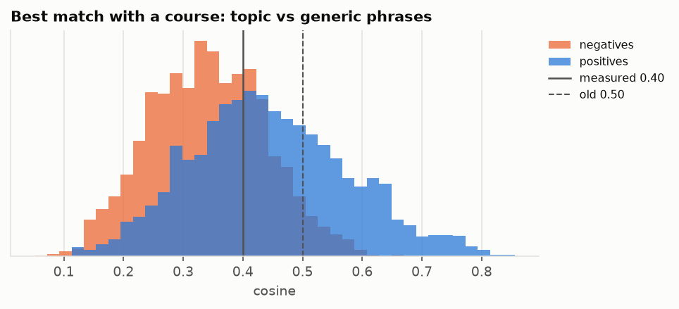
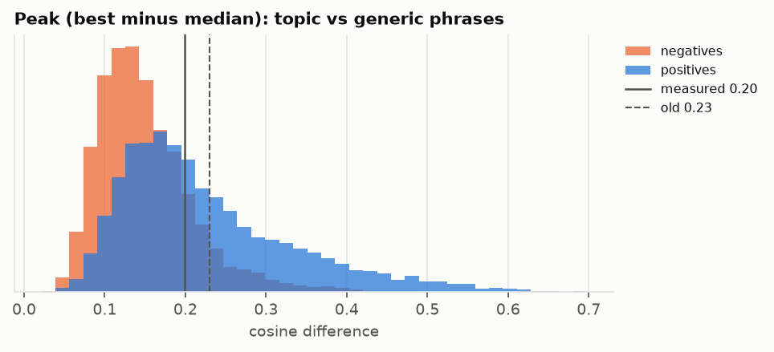
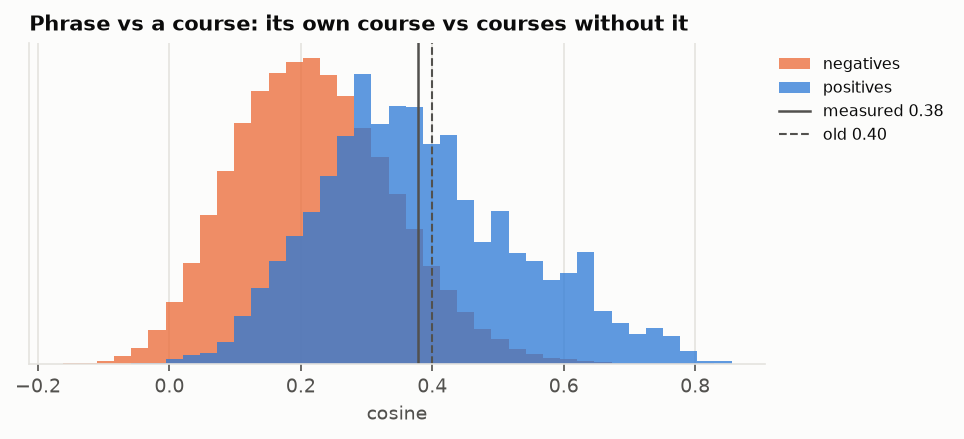
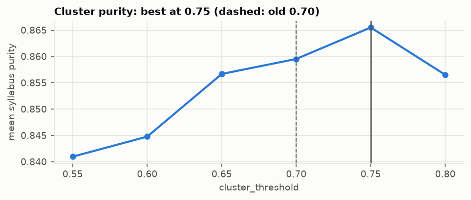

# Calibration of the candidate thresholds

Thresholds: 49 curricula, 1493 courses to tag (electives only when `electives_only`), pooled. Cluster threshold: 20 curricula with specializations. Generated by `python -m tag_classifier.calibrate`; method in its docstring. No human labels: positives are phrases the pipeline picked as a course's top topic phrases; negatives are generic phrases (common across the catalogue) or courses whose syllabus does not contain the phrase. Each threshold passes the most positives while letting through at most 10% of the negatives (`max_false_positive_rate`).

| Threshold | Old | Measured | TPR / FPR measured | TPR / FPR old | Positives / negatives |
|---|---|---|---|---|---|
| `min_best_match` | 0.50 | 0.401 | 0.42 / 0.10 | 0.25 / 0.03 | 11733 / 14828 |
| `min_peak` | 0.23 | 0.199 | 0.42 / 0.10 | 0.25 / 0.03 | 11733 / 14828 |
| `semantic_threshold` | 0.40 | 0.377 | 0.46 / 0.10 | 0.41 / 0.07 | 11930 / 404278 |

`min_best_match` and `min_peak` are chosen together for the combined rule, so they share one TPR / FPR.
Positives are picked partly by their similarity to their course: treat TPR as optimistic.

## Cluster threshold

Old 0.70, measured **0.75** (highest mean syllabus purity, with the measured thresholds above).

| cluster_threshold | Mean purity | Overlapping pairs | Candidates |
|---|---|---|---|
| 0.55 | 0.841 | 12.1 | 36.1 |
| 0.60 | 0.845 | 11.7 | 35.4 |
| 0.65 | 0.857 | 10.9 | 33.0 |
| 0.70 | 0.860 | 10.0 | 30.3 |
| 0.75 | 0.865 | 8.8 | 27.1 |
| 0.80 | 0.857 | 8.8 | 23.1 |

## Curricula measured

| Curriculum | Courses | Topic phrases | Generic phrases |
|---|---|---|---|
| AE-2023-KTHK | 20 | 158 | 308 |
| AE-2024-KTHK | 23 | 182 | 319 |
| AE-2026-KTHK | 20 | 159 | 303 |
| AUT-2026-KTOT | 33 | 263 | 341 |
| BA-2025-QTKD | 21 | 168 | 302 |
| BA-2026-QTKD | 26 | 207 | 318 |
| CE-2023-KTMT | 23 | 173 | 271 |
| CE-2024-KTMT | 23 | 172 | 264 |
| CE-2026-KTMT | 26 | 195 | 274 |
| CHE-2023-KTHH | 29 | 231 | 298 |
| CHE-2024-KTHH | 41 | 328 | 309 |
| CHE-2026-KTHH | 41 | 327 | 308 |
| CS-2023-KHMT | 55 | 413 | 321 |
| CS-2024-KHMT | 51 | 381 | 319 |
| CS-2026-KHMT | 54 | 404 | 320 |
| DM-2023-2DK | 35 | 279 | 313 |
| DM-2023-2DT | 28 | 224 | 288 |
| DM-2023-2KD | 35 | 279 | 313 |
| DM-2023-2KT | 28 | 223 | 296 |
| DM-2023-2TD | 28 | 224 | 288 |
| DM-2023-2TK | 28 | 223 | 296 |
| DM-2023-THK | 26 | 206 | 323 |
| DM-2024-THK | 31 | 245 | 331 |
| EE-2023-KTDIEN | 22 | 175 | 288 |
| EE-2024-KTDIEN | 24 | 191 | 302 |
| EE-2026-KTDIEN | 25 | 198 | 301 |
| EM-2023-CKT | 20 | 160 | 248 |
| ENV-2023-KTMTR | 20 | 159 | 296 |
| ENV-2024-KTMTR | 24 | 191 | 313 |
| ENV-2026-KTMTR | 27 | 214 | 316 |
| EP-2023-VLKT | 28 | 224 | 298 |
| EP-2024-VLKT | 25 | 200 | 302 |
| EP-2026-VLKT | 28 | 223 | 306 |
| ET-2023-DTVT | 20 | 160 | 264 |
| ET-2024-DTVT | 21 | 168 | 282 |
| ET-2026-DTVT | 23 | 183 | 281 |
| GE-2023-KTDC | 25 | 192 | 220 |
| IM-2023-QLCN | 34 | 267 | 321 |
| IM-2024-QLCN | 34 | 267 | 321 |
| IM-2026-QLCN | 43 | 336 | 333 |
| MCE-2024-CDT | 20 | 160 | 295 |
| MCE-2026-CDT | 25 | 199 | 309 |
| MSE-2023-KTVL | 70 | 550 | 346 |
| MSE-2024-KTVL | 78 | 613 | 349 |
| MSE-2026-KTVL | 44 | 349 | 332 |
| NR-2023-QLTNMT | 20 | 151 | 293 |
| NR-2026-QLTNMT | 26 | 205 | 304 |
| NRE-2026-KTTNTN | 20 | 159 | 275 |
| RE-2026-KTDS | 22 | 175 | 310 |
