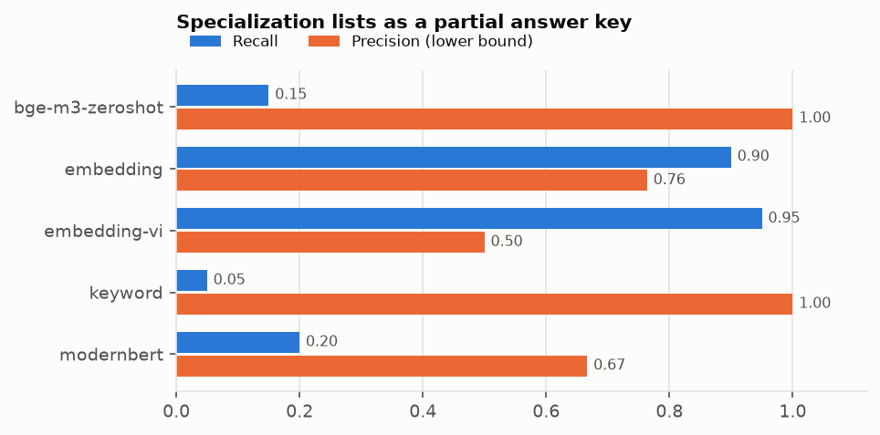
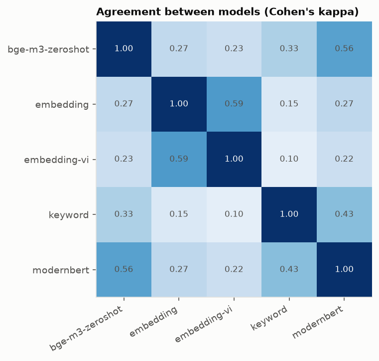
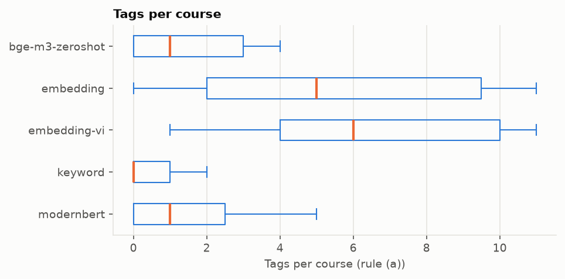

# Evaluation: AR-KT

19 courses scored, models: bge-m3-zeroshot, embedding, embedding-vi, keyword, modernbert. No human labels: every number below comes from the faculty's own course lists or from comparing scorers with each other.

## Specialization recall

Each specialization's course list (written by the faculty) is a partial answer key. Recall = share of listed courses that got the specialization tag. Precision is a lower bound: a course outside the list may still deserve the tag.

| Model | Recall | Precision (lb) | DH_CQ_XD_CN_7580101_KTCQ _2024 | DH_CQ_XD_CN_7580101_KTCQ _2026 | KCQ | KT |
|---|---|---|---|---|---|---|
| bge-m3-zeroshot | 0.15 | 1.00 | 0.20 | 0.00 | 0.40 | 0.00 |
| embedding | 0.90 | 0.76 | 1.00 | 0.60 | 1.00 | 1.00 |
| embedding-vi | 0.95 | 0.50 | 1.00 | 1.00 | 0.80 | 1.00 |
| keyword | 0.05 | 1.00 | 0.20 | 0.00 | 0.00 | 0.00 |
| modernbert | 0.20 | 0.67 | 0.20 | 0.00 | 0.60 | 0.00 |

## Agreement between models

| Pair | Cohen's kappa |
|---|---|
| bge-m3-zeroshot vs embedding | 0.27 |
| bge-m3-zeroshot vs embedding-vi | 0.23 |
| bge-m3-zeroshot vs keyword | 0.33 |
| bge-m3-zeroshot vs modernbert | 0.56 |
| embedding vs embedding-vi | 0.59 |
| embedding vs keyword | 0.15 |
| embedding vs modernbert | 0.27 |
| embedding-vi vs keyword | 0.10 |
| embedding-vi vs modernbert | 0.22 |
| keyword vs modernbert | 0.43 |

Krippendorff's alpha per tag across models: mean 0.19; 2 of 21 tags reach 0.667 (tags every model left out of every course have no defined alpha).

## Section consistency

Tags from the summary alone vs tags from the other sections (Jaccard, 1 = same tags). Low agreement flags syllabi whose sections disagree; copied summaries (the provider's error) are counted apart.

| Model | Jaccard | Courses | Copied summaries: Jaccard | Courses |
|---|---|---|---|---|
| bge-m3-zeroshot | 0.41 | 19 | – | 0 |
| embedding | 0.51 | 19 | – | 0 |
| embedding-vi | 0.52 | 19 | – | 0 |
| keyword | 0.61 | 19 | – | 0 |
| modernbert | 0.55 | 19 | – | 0 |

## Language stability

| Same scorer, English vs Vietnamese text | Jaccard of course tags |
|---|---|
| embedding vs embedding-vi | 0.49 |

## Tags per course

| Model | Mean | Median | Courses with no tag | Max |
|---|---|---|---|---|
| bge-m3-zeroshot | 1.7 | 1 | 6 | 4 |
| embedding | 5.4 | 5 | 2 | 11 |
| embedding-vi | 6.7 | 6 | 0 | 11 |
| keyword | 0.6 | 0 | 10 | 2 |
| modernbert | 1.5 | 1 | 6 | 5 |

## Run time

| Model | Pairs | Scored this run | Seconds | Seconds per pair |
|---|---|---|---|---|
| bge-m3-zeroshot | 1672 | 0 | 0.0 | – |
| embedding | 1672 | 0 | 0.0 | – |
| embedding-vi | 1672 | 0 | 0.0 | – |
| keyword | 1672 | 0 | 0.0 | – |
| modernbert | 1672 | 0 | 0.0 | – |

Times are from the machine that ran `classify` (this laptop's CPU unless noted); pairs already in the cache cost nothing and are not timed.
