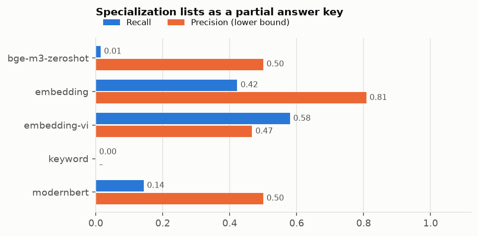
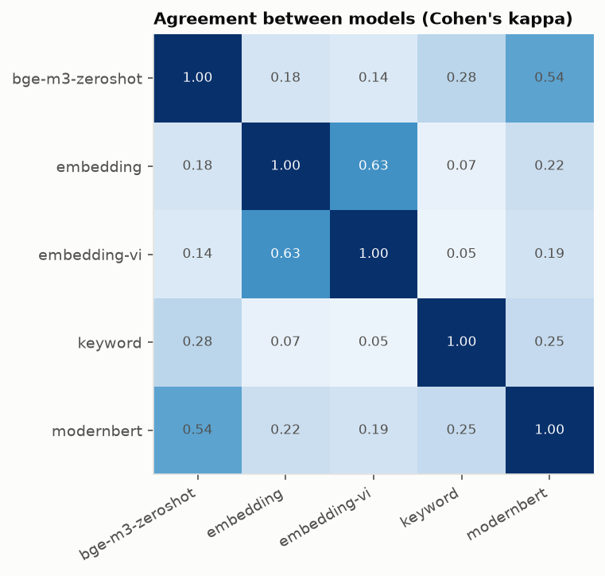
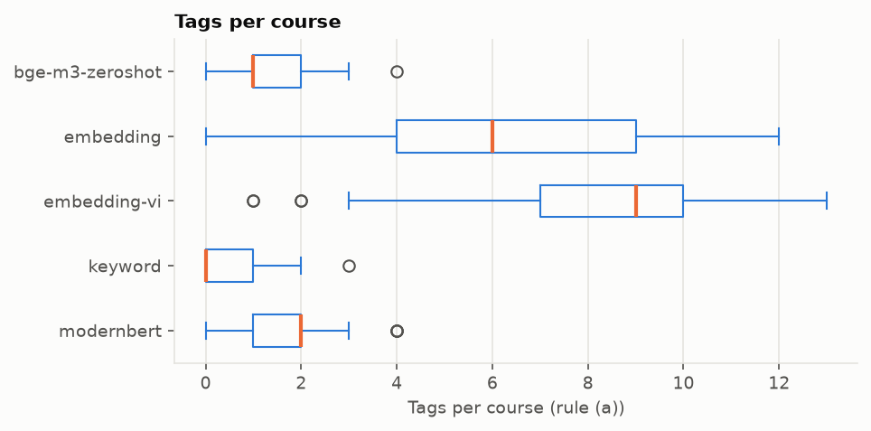

# Evaluation: CHE-KTHH

54 courses scored, models: bge-m3-zeroshot, embedding, embedding-vi, keyword, modernbert. No human labels: every number below comes from the faculty's own course lists or from comparing scorers with each other.

## Specialization recall

Each specialization's course list (written by the faculty) is a partial answer key. Recall = share of listed courses that got the specialization tag. Precision is a lower bound: a course outside the list may still deserve the tag.

| Model | Recall | Precision (lb) | CNHD | CNMP | KTHH |
|---|---|---|---|---|---|
| bge-m3-zeroshot | 0.01 | 0.50 | 0.00 | 0.00 | 0.04 |
| embedding | 0.42 | 0.81 | 0.57 | 0.00 | 0.70 |
| embedding-vi | 0.58 | 0.47 | 1.00 | 0.00 | 0.74 |
| keyword | 0.00 | – | 0.00 | 0.00 | 0.00 |
| modernbert | 0.14 | 0.50 | 0.43 | 0.00 | 0.00 |

## Agreement between models

| Pair | Cohen's kappa |
|---|---|
| bge-m3-zeroshot vs embedding | 0.18 |
| bge-m3-zeroshot vs embedding-vi | 0.14 |
| bge-m3-zeroshot vs keyword | 0.28 |
| bge-m3-zeroshot vs modernbert | 0.54 |
| embedding vs embedding-vi | 0.63 |
| embedding vs keyword | 0.07 |
| embedding vs modernbert | 0.22 |
| embedding-vi vs keyword | 0.05 |
| embedding-vi vs modernbert | 0.19 |
| keyword vs modernbert | 0.25 |

Krippendorff's alpha per tag across models: mean 0.23; 2 of 49 tags reach 0.667 (tags every model left out of every course have no defined alpha).

## Section consistency

Tags from the summary alone vs tags from the other sections (Jaccard, 1 = same tags). Low agreement flags syllabi whose sections disagree; copied summaries (the provider's error) are counted apart.

| Model | Jaccard | Courses | Copied summaries: Jaccard | Courses |
|---|---|---|---|---|
| bge-m3-zeroshot | 0.45 | 54 | – | 0 |
| embedding | 0.39 | 54 | – | 0 |
| embedding-vi | 0.47 | 54 | – | 0 |
| keyword | 0.59 | 54 | – | 0 |
| modernbert | 0.49 | 54 | – | 0 |

## Language stability

| Same scorer, English vs Vietnamese text | Jaccard of course tags |
|---|---|
| embedding vs embedding-vi | 0.52 |

## Tags per course

| Model | Mean | Median | Courses with no tag | Max |
|---|---|---|---|---|
| bge-m3-zeroshot | 1.4 | 1 | 11 | 4 |
| embedding | 6.5 | 6 | 1 | 12 |
| embedding-vi | 8.2 | 9 | 0 | 13 |
| keyword | 0.4 | 0 | 38 | 3 |
| modernbert | 1.6 | 2 | 9 | 4 |

## Run time

| Model | Pairs | Scored this run | Seconds | Seconds per pair |
|---|---|---|---|---|
| bge-m3-zeroshot | 10584 | 0 | 0.0 | – |
| embedding | 10584 | 0 | 0.0 | – |
| embedding-vi | 10584 | 0 | 0.0 | – |
| keyword | 10584 | 0 | 0.0 | – |
| modernbert | 10584 | 0 | 0.0 | – |

Times are from the machine that ran `classify` (this laptop's CPU unless noted); pairs already in the cache cost nothing and are not timed.
