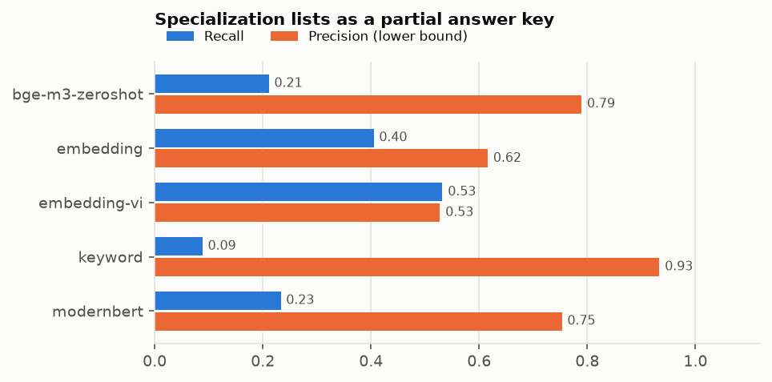
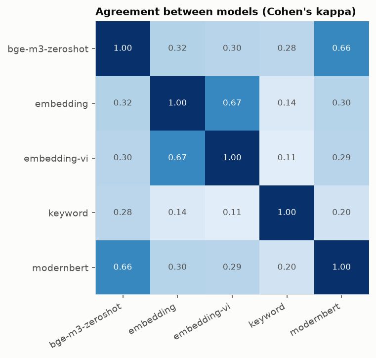
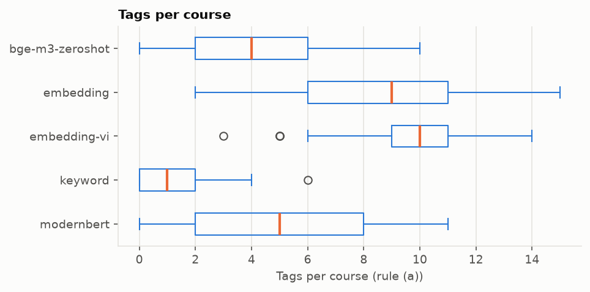

# Evaluation: CS-KHMT

60 courses scored, models: bge-m3-zeroshot, embedding, embedding-vi, keyword, modernbert. No human labels: every number below comes from the faculty's own course lists or from comparing scorers with each other.

## Specialization recall

Each specialization's course list (written by the faculty) is a partial answer key. Recall = share of listed courses that got the specialization tag. Precision is a lower bound: a course outside the list may still deserve the tag.

| Model | Recall | Precision (lb) | AI | ANM | CND | CNP | CNPM | KHDL | MMA | TNT | XLA |
|---|---|---|---|---|---|---|---|---|---|---|---|
| bge-m3-zeroshot | 0.21 | 0.79 | 0.17 | 0.10 | 0.08 | 0.78 | 0.22 | 0.17 | 0.12 | 0.13 | 0.12 |
| embedding | 0.40 | 0.62 | 0.25 | 0.40 | 0.25 | 0.67 | 0.78 | 0.33 | 0.38 | 0.47 | 0.12 |
| embedding-vi | 0.53 | 0.53 | 0.75 | 0.40 | 0.42 | 0.78 | 0.78 | 0.50 | 0.25 | 0.67 | 0.25 |
| keyword | 0.09 | 0.93 | 0.25 | 0.10 | 0.08 | 0.11 | 0.00 | 0.00 | 0.12 | 0.00 | 0.12 |
| modernbert | 0.23 | 0.75 | 0.08 | 0.10 | 0.08 | 0.89 | 0.33 | 0.17 | 0.25 | 0.07 | 0.12 |

## Agreement between models

| Pair | Cohen's kappa |
|---|---|
| bge-m3-zeroshot vs embedding | 0.32 |
| bge-m3-zeroshot vs embedding-vi | 0.30 |
| bge-m3-zeroshot vs keyword | 0.28 |
| bge-m3-zeroshot vs modernbert | 0.66 |
| embedding vs embedding-vi | 0.67 |
| embedding vs keyword | 0.14 |
| embedding vs modernbert | 0.30 |
| embedding-vi vs keyword | 0.11 |
| embedding-vi vs modernbert | 0.29 |
| keyword vs modernbert | 0.20 |

Krippendorff's alpha per tag across models: mean 0.31; 6 of 67 tags reach 0.667 (tags every model left out of every course have no defined alpha).

## Section consistency

Tags from the summary alone vs tags from the other sections (Jaccard, 1 = same tags). Low agreement flags syllabi whose sections disagree; copied summaries (the provider's error) are counted apart.

| Model | Jaccard | Courses | Copied summaries: Jaccard | Courses |
|---|---|---|---|---|
| bge-m3-zeroshot | 0.57 | 56 | 0.42 | 4 |
| embedding | 0.45 | 56 | 0.63 | 4 |
| embedding-vi | 0.43 | 56 | 0.44 | 4 |
| keyword | 0.50 | 56 | 0.12 | 4 |
| modernbert | 0.56 | 56 | 0.20 | 4 |

## Language stability

| Same scorer, English vs Vietnamese text | Jaccard of course tags |
|---|---|
| embedding vs embedding-vi | 0.56 |

## Tags per course

| Model | Mean | Median | Courses with no tag | Max |
|---|---|---|---|---|
| bge-m3-zeroshot | 3.9 | 4 | 4 | 10 |
| embedding | 8.3 | 9 | 0 | 15 |
| embedding-vi | 9.8 | 10 | 0 | 14 |
| keyword | 1.2 | 1 | 22 | 6 |
| modernbert | 5.0 | 5 | 8 | 11 |

## Run time

| Model | Pairs | Scored this run | Seconds | Seconds per pair |
|---|---|---|---|---|
| bge-m3-zeroshot | 16252 | 0 | 0.0 | – |
| embedding | 16252 | 0 | 0.0 | – |
| embedding-vi | 16252 | 0 | 0.0 | – |
| keyword | 16252 | 0 | 0.0 | – |
| modernbert | 16252 | 0 | 0.0 | – |

Times are from the machine that ran `classify` (this laptop's CPU unless noted); pairs already in the cache cost nothing and are not timed.
