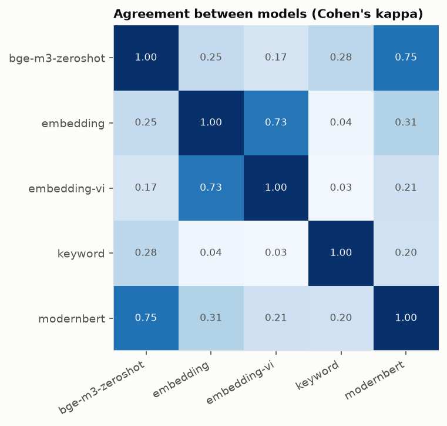
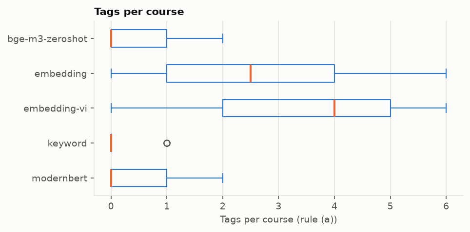

# Evaluation: DM-2TD

28 courses scored, models: bge-m3-zeroshot, embedding, embedding-vi, keyword, modernbert. No human labels: every number below comes from the faculty's own course lists or from comparing scorers with each other.

## Specialization recall

Each specialization's course list (written by the faculty) is a partial answer key. Recall = share of listed courses that got the specialization tag. Precision is a lower bound: a course outside the list may still deserve the tag.

| Model | Recall | Precision (lb) |
|---|---|---|
| bge-m3-zeroshot | – | – |
| embedding | – | – |
| embedding-vi | – | – |
| keyword | – | – |
| modernbert | – | – |

## Agreement between models

| Pair | Cohen's kappa |
|---|---|
| bge-m3-zeroshot vs embedding | 0.25 |
| bge-m3-zeroshot vs embedding-vi | 0.17 |
| bge-m3-zeroshot vs keyword | 0.28 |
| bge-m3-zeroshot vs modernbert | 0.75 |
| embedding vs embedding-vi | 0.73 |
| embedding vs keyword | 0.04 |
| embedding vs modernbert | 0.31 |
| embedding-vi vs keyword | 0.03 |
| embedding-vi vs modernbert | 0.21 |
| keyword vs modernbert | 0.20 |

Krippendorff's alpha per tag across models: mean 0.23; 0 of 11 tags reach 0.667 (tags every model left out of every course have no defined alpha).

## Section consistency

Tags from the summary alone vs tags from the other sections (Jaccard, 1 = same tags). Low agreement flags syllabi whose sections disagree; copied summaries (the provider's error) are counted apart.

| Model | Jaccard | Courses | Copied summaries: Jaccard | Courses |
|---|---|---|---|---|
| bge-m3-zeroshot | 0.81 | 27 | 0.00 | 1 |
| embedding | 0.64 | 27 | 0.67 | 1 |
| embedding-vi | 0.61 | 27 | 0.67 | 1 |
| keyword | 0.85 | 27 | 0.00 | 1 |
| modernbert | 0.81 | 27 | 0.00 | 1 |

## Language stability

| Same scorer, English vs Vietnamese text | Jaccard of course tags |
|---|---|
| embedding vs embedding-vi | 0.63 |

## Tags per course

| Model | Mean | Median | Courses with no tag | Max |
|---|---|---|---|---|
| bge-m3-zeroshot | 0.4 | 0 | 18 | 2 |
| embedding | 2.5 | 2 | 6 | 6 |
| embedding-vi | 3.4 | 4 | 2 | 6 |
| keyword | 0.1 | 0 | 26 | 1 |
| modernbert | 0.6 | 0 | 16 | 2 |

## Run time

| Model | Pairs | Scored this run | Seconds | Seconds per pair |
|---|---|---|---|---|
| bge-m3-zeroshot | 1456 | 0 | 0.0 | – |
| embedding | 1456 | 0 | 0.0 | – |
| embedding-vi | 1456 | 0 | 0.0 | – |
| keyword | 1232 | 0 | 0.0 | – |
| modernbert | 1232 | 0 | 0.0 | – |

Times are from the machine that ran `classify` (this laptop's CPU unless noted); pairs already in the cache cost nothing and are not timed.
