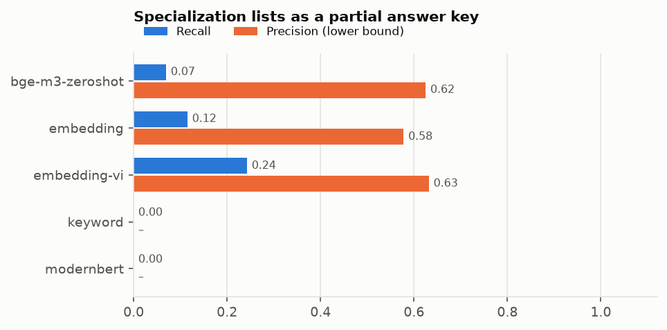
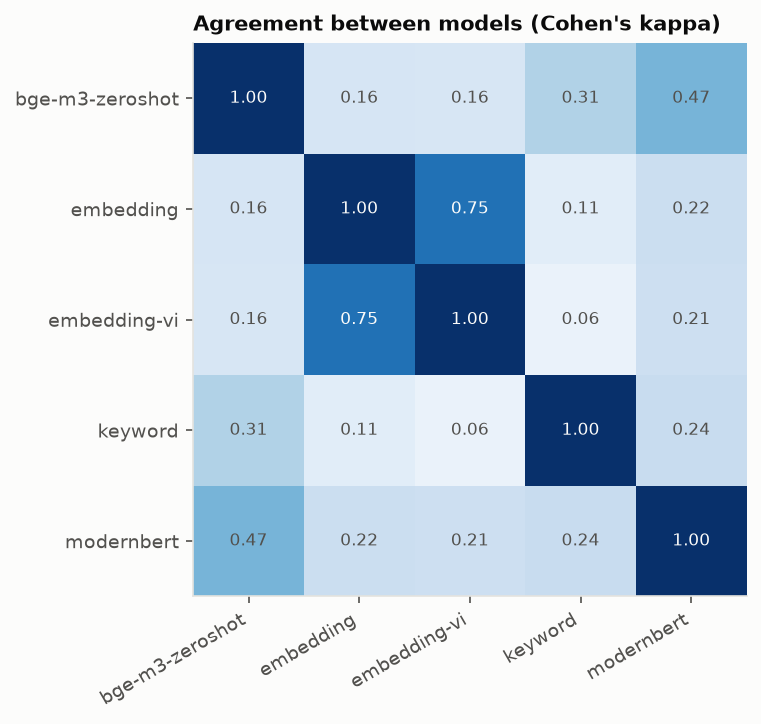
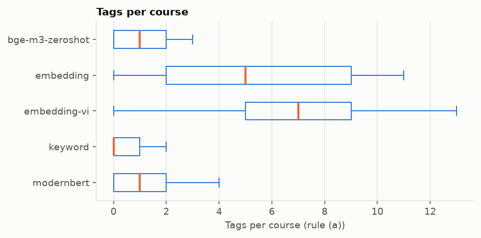
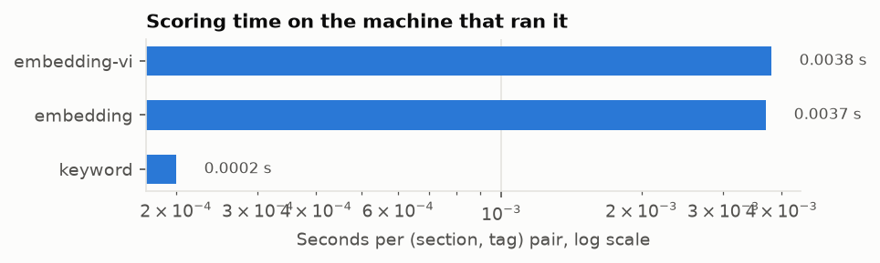

# Evaluation: EP-VLKT

37 courses scored, models: bge-m3-zeroshot, embedding, embedding-vi, keyword, modernbert. No human labels: every number below comes from the faculty's own course lists or from comparing scorers with each other.

## Specialization recall

Each specialization's course list (written by the faculty) is a partial answer key. Recall = share of listed courses that got the specialization tag. Precision is a lower bound: a course outside the list may still deserve the tag.

| Model | Recall | Precision (lb) | KTYS | KYS | VLKT | VLTT |
|---|---|---|---|---|---|---|
| bge-m3-zeroshot | 0.07 | 0.62 | 0.00 | 0.00 | 0.00 | 0.28 |
| embedding | 0.12 | 0.58 | 0.00 | 0.00 | 0.29 | 0.17 |
| embedding-vi | 0.24 | 0.63 | 0.00 | 0.00 | 0.47 | 0.50 |
| keyword | 0.00 | – | – | – | 0.00 | 0.00 |
| modernbert | 0.00 | – | – | – | 0.00 | 0.00 |

## Agreement between models

| Pair | Cohen's kappa |
|---|---|
| bge-m3-zeroshot vs embedding | 0.16 |
| bge-m3-zeroshot vs embedding-vi | 0.16 |
| bge-m3-zeroshot vs keyword | 0.31 |
| bge-m3-zeroshot vs modernbert | 0.47 |
| embedding vs embedding-vi | 0.75 |
| embedding vs keyword | 0.11 |
| embedding vs modernbert | 0.22 |
| embedding-vi vs keyword | 0.06 |
| embedding-vi vs modernbert | 0.21 |
| keyword vs modernbert | 0.24 |

Krippendorff's alpha per tag across models: mean 0.26; 2 of 35 tags reach 0.667 (tags every model left out of every course have no defined alpha).

## Section consistency

Tags from the summary alone vs tags from the other sections (Jaccard, 1 = same tags). Low agreement flags syllabi whose sections disagree; copied summaries (the provider's error) are counted apart.

| Model | Jaccard | Courses | Copied summaries: Jaccard | Courses |
|---|---|---|---|---|
| bge-m3-zeroshot | 0.59 | 37 | – | 0 |
| embedding | 0.57 | 37 | – | 0 |
| embedding-vi | 0.49 | 37 | – | 0 |
| keyword | 0.53 | 37 | – | 0 |
| modernbert | 0.61 | 37 | – | 0 |

## Language stability

| Same scorer, English vs Vietnamese text | Jaccard of course tags |
|---|---|
| embedding vs embedding-vi | 0.64 |

## Tags per course

| Model | Mean | Median | Courses with no tag | Max |
|---|---|---|---|---|
| bge-m3-zeroshot | 0.9 | 1 | 15 | 3 |
| embedding | 5.3 | 5 | 1 | 11 |
| embedding-vi | 6.8 | 7 | 1 | 13 |
| keyword | 0.4 | 0 | 23 | 2 |
| modernbert | 1.1 | 1 | 17 | 4 |

## Run time

| Model | Pairs | Scored this run | Seconds | Seconds per pair |
|---|---|---|---|---|
| bge-m3-zeroshot | 5476 | 0 | 0.0 | – |
| embedding | 5476 | 5012 | 18.4 | 0.004 |
| embedding-vi | 5476 | 4904 | 18.8 | 0.004 |
| keyword | 4719 | 4523 | 0.8 | 0.000 |
| modernbert | 4719 | 0 | 0.0 | – |

Times are from the machine that ran `classify` (this laptop's CPU unless noted); pairs already in the cache cost nothing and are not timed.
