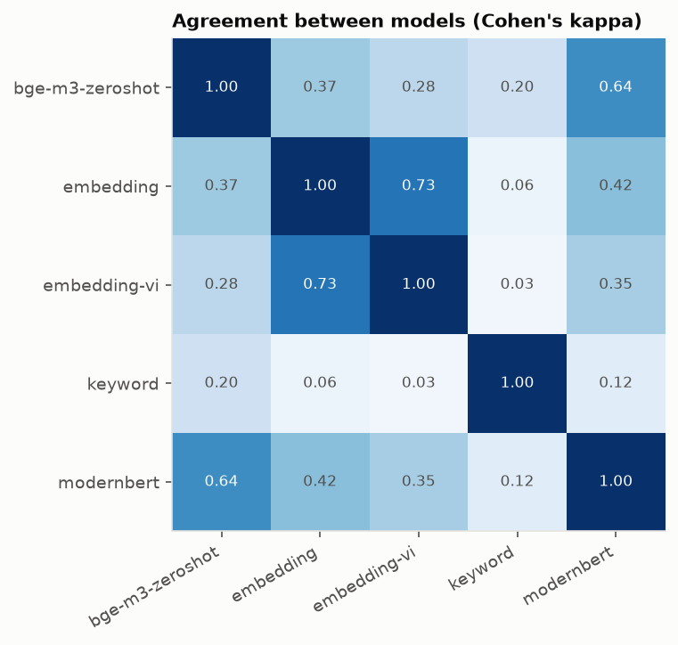
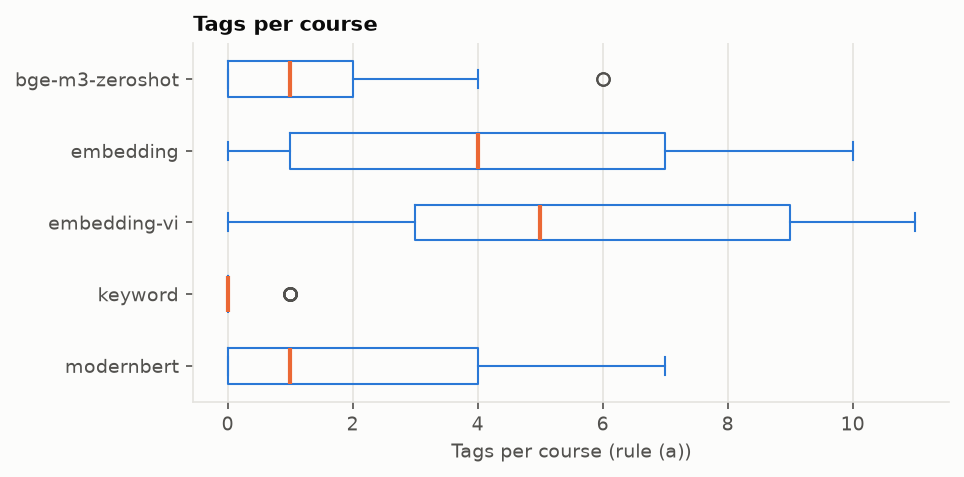
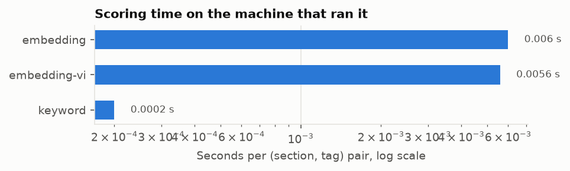

# Evaluation: ET-DTVT

29 courses scored, models: bge-m3-zeroshot, embedding, embedding-vi, keyword, modernbert. No human labels: every number below comes from the faculty's own course lists or from comparing scorers with each other.

## Specialization recall

Each specialization's course list (written by the faculty) is a partial answer key. Recall = share of listed courses that got the specialization tag. Precision is a lower bound: a course outside the list may still deserve the tag.

| Model | Recall | Precision (lb) |
|---|---|---|
| bge-m3-zeroshot | – | – |
| embedding | – | – |
| embedding-vi | – | – |
| keyword | – | – |
| modernbert | – | – |

## Agreement between models

| Pair | Cohen's kappa |
|---|---|
| bge-m3-zeroshot vs embedding | 0.37 |
| bge-m3-zeroshot vs embedding-vi | 0.28 |
| bge-m3-zeroshot vs keyword | 0.20 |
| bge-m3-zeroshot vs modernbert | 0.64 |
| embedding vs embedding-vi | 0.73 |
| embedding vs keyword | 0.06 |
| embedding vs modernbert | 0.42 |
| embedding-vi vs keyword | 0.03 |
| embedding-vi vs modernbert | 0.35 |
| keyword vs modernbert | 0.12 |

Krippendorff's alpha per tag across models: mean 0.30; 0 of 25 tags reach 0.667 (tags every model left out of every course have no defined alpha).

## Section consistency

Tags from the summary alone vs tags from the other sections (Jaccard, 1 = same tags). Low agreement flags syllabi whose sections disagree; copied summaries (the provider's error) are counted apart.

| Model | Jaccard | Courses | Copied summaries: Jaccard | Courses |
|---|---|---|---|---|
| bge-m3-zeroshot | 0.71 | 27 | 0.00 | 2 |
| embedding | 0.54 | 27 | 0.56 | 2 |
| embedding-vi | 0.49 | 27 | 0.45 | 2 |
| keyword | 0.80 | 27 | 0.00 | 2 |
| modernbert | 0.72 | 27 | 0.33 | 2 |

## Language stability

| Same scorer, English vs Vietnamese text | Jaccard of course tags |
|---|---|
| embedding vs embedding-vi | 0.60 |

## Tags per course

| Model | Mean | Median | Courses with no tag | Max |
|---|---|---|---|---|
| bge-m3-zeroshot | 1.4 | 1 | 12 | 6 |
| embedding | 4.2 | 4 | 2 | 10 |
| embedding-vi | 5.6 | 5 | 1 | 11 |
| keyword | 0.2 | 0 | 22 | 1 |
| modernbert | 1.9 | 1 | 13 | 7 |

## Run time

| Model | Pairs | Scored this run | Seconds | Seconds per pair |
|---|---|---|---|---|
| bge-m3-zeroshot | 2900 | 0 | 0.0 | – |
| embedding | 2900 | 2220 | 13.2 | 0.006 |
| embedding-vi | 2900 | 2087 | 11.7 | 0.006 |
| keyword | 2784 | 2316 | 0.5 | 0.000 |
| modernbert | 2784 | 0 | 0.0 | – |

Times are from the machine that ran `classify` (this laptop's CPU unless noted); pairs already in the cache cost nothing and are not timed.
