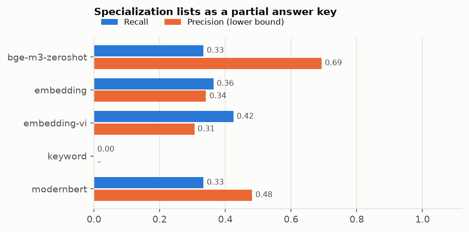
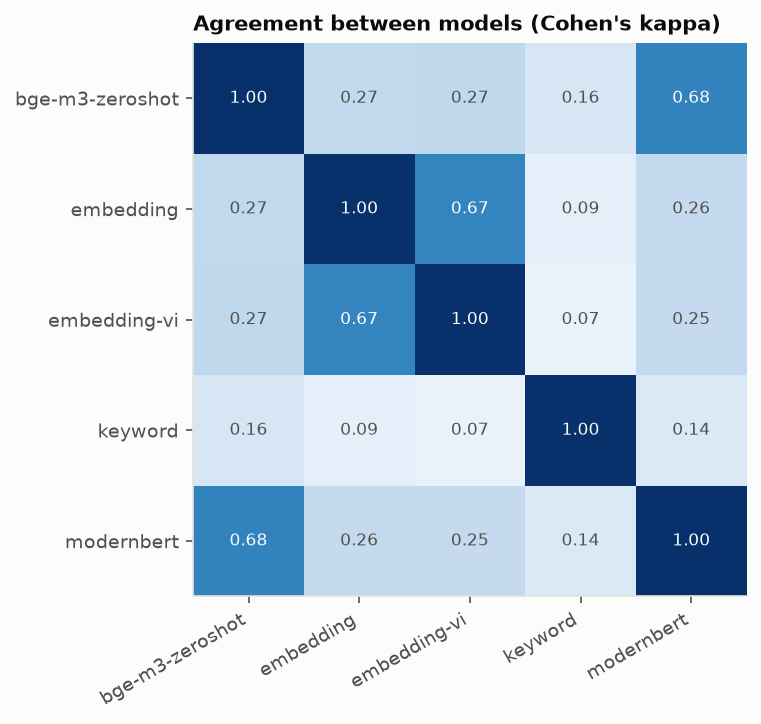
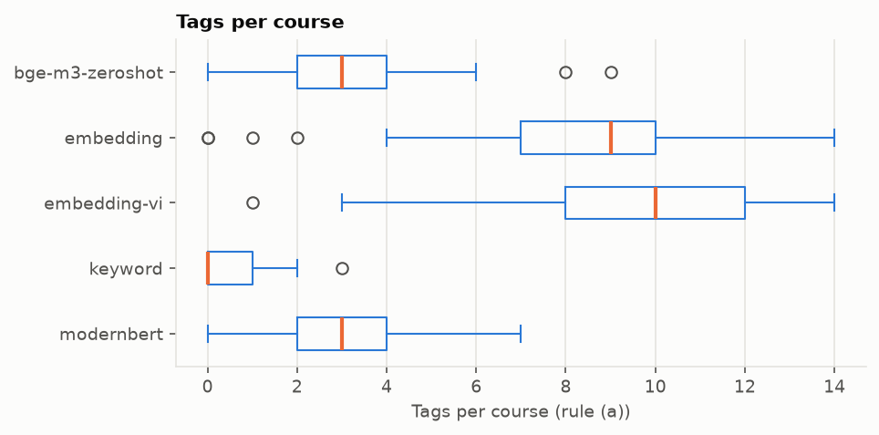
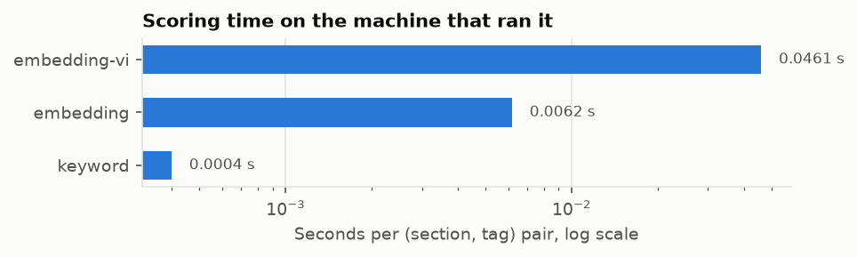

# Evaluation: GE-KTDC

37 courses scored, models: bge-m3-zeroshot, embedding, embedding-vi, keyword, modernbert. No human labels: every number below comes from the faculty's own course lists or from comparing scorers with each other.

## Specialization recall

Each specialization's course list (written by the faculty) is a partial answer key. Recall = share of listed courses that got the specialization tag. Precision is a lower bound: a course outside the list may still deserve the tag.

| Model | Recall | Precision (lb) | DCM | DKT | QDK |
|---|---|---|---|---|---|
| bge-m3-zeroshot | 0.33 | 0.69 | 0.18 | 0.64 | 0.18 |
| embedding | 0.36 | 0.34 | 0.64 | 0.09 | 0.36 |
| embedding-vi | 0.42 | 0.31 | 0.36 | 0.64 | 0.27 |
| keyword | 0.00 | – | 0.00 | 0.00 | 0.00 |
| modernbert | 0.33 | 0.48 | 0.18 | 0.73 | 0.09 |

## Agreement between models

| Pair | Cohen's kappa |
|---|---|
| bge-m3-zeroshot vs embedding | 0.27 |
| bge-m3-zeroshot vs embedding-vi | 0.27 |
| bge-m3-zeroshot vs keyword | 0.16 |
| bge-m3-zeroshot vs modernbert | 0.68 |
| embedding vs embedding-vi | 0.67 |
| embedding vs keyword | 0.09 |
| embedding vs modernbert | 0.26 |
| embedding-vi vs keyword | 0.07 |
| embedding-vi vs modernbert | 0.25 |
| keyword vs modernbert | 0.14 |

Krippendorff's alpha per tag across models: mean 0.23; 0 of 36 tags reach 0.667 (tags every model left out of every course have no defined alpha).

## Section consistency

Tags from the summary alone vs tags from the other sections (Jaccard, 1 = same tags). Low agreement flags syllabi whose sections disagree; copied summaries (the provider's error) are counted apart.

| Model | Jaccard | Courses | Copied summaries: Jaccard | Courses |
|---|---|---|---|---|
| bge-m3-zeroshot | 0.45 | 37 | – | 0 |
| embedding | 0.44 | 37 | – | 0 |
| embedding-vi | 0.47 | 37 | – | 0 |
| keyword | 0.54 | 36 | – | 0 |
| modernbert | 0.38 | 36 | – | 0 |

## Language stability

| Same scorer, English vs Vietnamese text | Jaccard of course tags |
|---|---|
| embedding vs embedding-vi | 0.58 |

## Tags per course

| Model | Mean | Median | Courses with no tag | Max |
|---|---|---|---|---|
| bge-m3-zeroshot | 3.1 | 3 | 2 | 9 |
| embedding | 8.1 | 9 | 2 | 14 |
| embedding-vi | 9.5 | 10 | 0 | 14 |
| keyword | 0.5 | 0 | 22 | 3 |
| modernbert | 2.9 | 3 | 3 | 7 |

## Run time

| Model | Pairs | Scored this run | Seconds | Seconds per pair |
|---|---|---|---|---|
| bge-m3-zeroshot | 5476 | 0 | 0.0 | – |
| embedding | 5476 | 5382 | 33.6 | 0.006 |
| embedding-vi | 5476 | 5305 | 244.3 | 0.046 |
| keyword | 5291 | 5234 | 2.2 | 0.000 |
| modernbert | 5291 | 0 | 0.0 | – |

Times are from the machine that ran `classify` (this laptop's CPU unless noted); pairs already in the cache cost nothing and are not timed.
