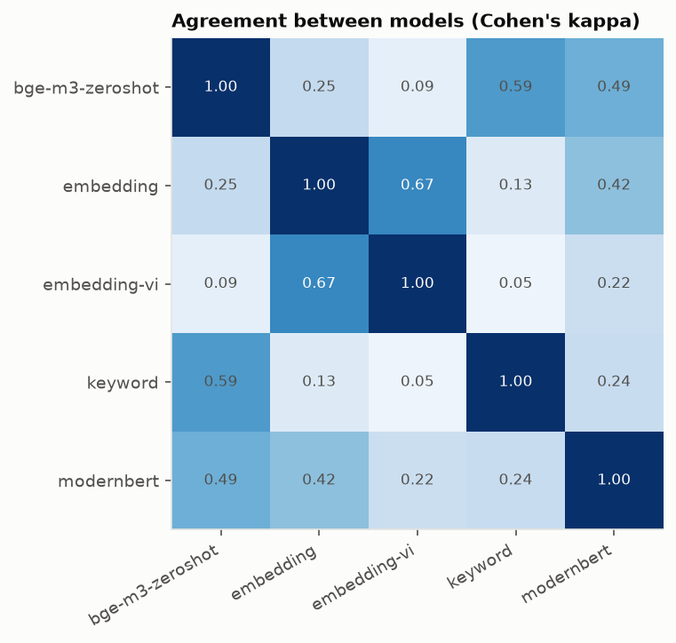
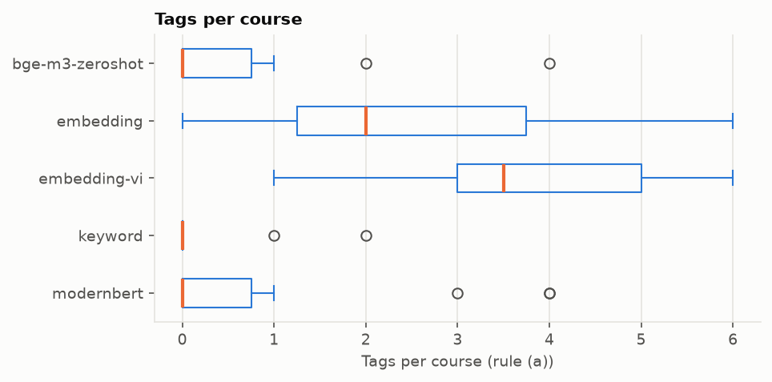
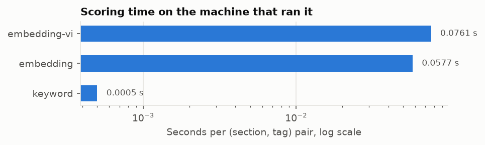

# Evaluation: ICD-TKVM

14 courses scored, models: bge-m3-zeroshot, embedding, embedding-vi, keyword, modernbert. No human labels: every number below comes from the faculty's own course lists or from comparing scorers with each other.

## Specialization recall

Each specialization's course list (written by the faculty) is a partial answer key. Recall = share of listed courses that got the specialization tag. Precision is a lower bound: a course outside the list may still deserve the tag.

| Model | Recall | Precision (lb) |
|---|---|---|
| bge-m3-zeroshot | – | – |
| embedding | – | – |
| embedding-vi | – | – |
| keyword | – | – |
| modernbert | – | – |

## Agreement between models

| Pair | Cohen's kappa |
|---|---|
| bge-m3-zeroshot vs embedding | 0.25 |
| bge-m3-zeroshot vs embedding-vi | 0.09 |
| bge-m3-zeroshot vs keyword | 0.59 |
| bge-m3-zeroshot vs modernbert | 0.49 |
| embedding vs embedding-vi | 0.67 |
| embedding vs keyword | 0.13 |
| embedding vs modernbert | 0.42 |
| embedding-vi vs keyword | 0.05 |
| embedding-vi vs modernbert | 0.22 |
| keyword vs modernbert | 0.24 |

Krippendorff's alpha per tag across models: mean 0.27; 0 of 11 tags reach 0.667 (tags every model left out of every course have no defined alpha).

## Section consistency

Tags from the summary alone vs tags from the other sections (Jaccard, 1 = same tags). Low agreement flags syllabi whose sections disagree; copied summaries (the provider's error) are counted apart.

| Model | Jaccard | Courses | Copied summaries: Jaccard | Courses |
|---|---|---|---|---|
| bge-m3-zeroshot | 0.74 | 14 | – | 0 |
| embedding | 0.69 | 14 | – | 0 |
| embedding-vi | 0.57 | 14 | – | 0 |
| keyword | 0.93 | 14 | – | 0 |
| modernbert | 0.82 | 14 | – | 0 |

## Language stability

| Same scorer, English vs Vietnamese text | Jaccard of course tags |
|---|---|
| embedding vs embedding-vi | 0.58 |

## Tags per course

| Model | Mean | Median | Courses with no tag | Max |
|---|---|---|---|---|
| bge-m3-zeroshot | 0.6 | 0 | 10 | 4 |
| embedding | 2.6 | 2 | 2 | 6 |
| embedding-vi | 3.6 | 3 | 0 | 6 |
| keyword | 0.2 | 0 | 12 | 2 |
| modernbert | 0.9 | 0 | 10 | 4 |

## Run time

| Model | Pairs | Scored this run | Seconds | Seconds per pair |
|---|---|---|---|---|
| bge-m3-zeroshot | 616 | 0 | 0.0 | – |
| embedding | 616 | 356 | 20.6 | 0.058 |
| embedding-vi | 616 | 348 | 26.5 | 0.076 |
| keyword | 560 | 380 | 0.2 | 0.001 |
| modernbert | 560 | 0 | 0.0 | – |

Times are from the machine that ran `classify` (this laptop's CPU unless noted); pairs already in the cache cost nothing and are not timed.
