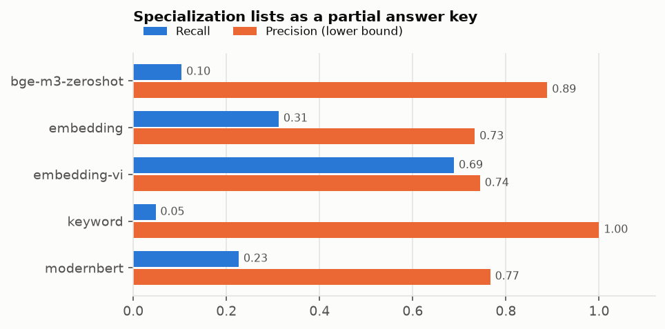
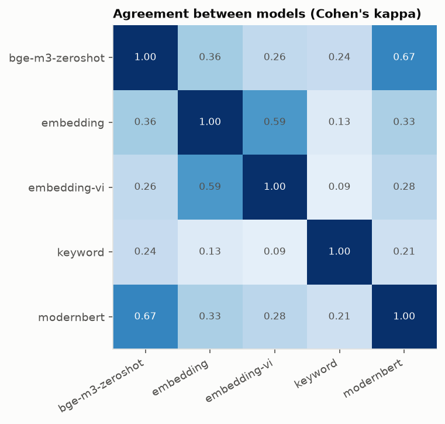
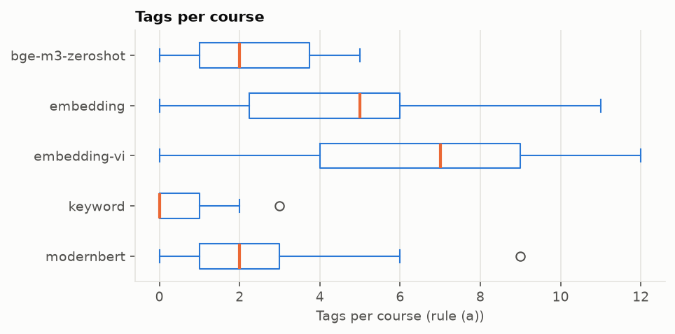
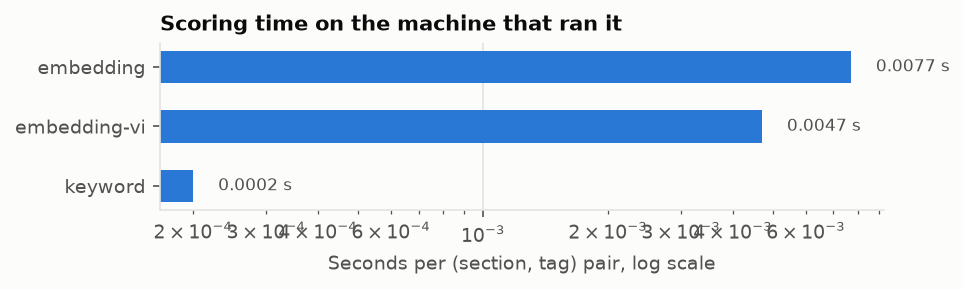

# Evaluation: IM-QLCN

46 courses scored, models: bge-m3-zeroshot, embedding, embedding-vi, keyword, modernbert. No human labels: every number below comes from the faculty's own course lists or from comparing scorers with each other.

## Specialization recall

Each specialization's course list (written by the faculty) is a partial answer key. Recall = share of listed courses that got the specialization tag. Precision is a lower bound: a course outside the list may still deserve the tag.

| Model | Recall | Precision (lb) | QCV | QKD | QLCN | QLCUVH | QTKD |
|---|---|---|---|---|---|---|---|
| bge-m3-zeroshot | 0.10 | 0.89 | 0.22 | 0.18 | 0.12 | 0.00 | 0.00 |
| embedding | 0.31 | 0.73 | 0.67 | 0.18 | 0.08 | 0.64 | 0.00 |
| embedding-vi | 0.69 | 0.74 | 0.89 | 0.64 | 0.50 | 0.82 | 0.60 |
| keyword | 0.05 | 1.00 | 0.11 | 0.09 | 0.04 | 0.00 | 0.00 |
| modernbert | 0.23 | 0.77 | 0.33 | 0.36 | 0.15 | 0.18 | 0.10 |

## Agreement between models

| Pair | Cohen's kappa |
|---|---|
| bge-m3-zeroshot vs embedding | 0.36 |
| bge-m3-zeroshot vs embedding-vi | 0.26 |
| bge-m3-zeroshot vs keyword | 0.24 |
| bge-m3-zeroshot vs modernbert | 0.67 |
| embedding vs embedding-vi | 0.59 |
| embedding vs keyword | 0.13 |
| embedding vs modernbert | 0.33 |
| embedding-vi vs keyword | 0.09 |
| embedding-vi vs modernbert | 0.28 |
| keyword vs modernbert | 0.21 |

Krippendorff's alpha per tag across models: mean 0.31; 2 of 38 tags reach 0.667 (tags every model left out of every course have no defined alpha).

## Section consistency

Tags from the summary alone vs tags from the other sections (Jaccard, 1 = same tags). Low agreement flags syllabi whose sections disagree; copied summaries (the provider's error) are counted apart.

| Model | Jaccard | Courses | Copied summaries: Jaccard | Courses |
|---|---|---|---|---|
| bge-m3-zeroshot | 0.48 | 44 | 0.50 | 1 |
| embedding | 0.44 | 44 | 0.00 | 1 |
| embedding-vi | 0.44 | 44 | 0.57 | 1 |
| keyword | 0.58 | 44 | 1.00 | 1 |
| modernbert | 0.52 | 44 | 0.00 | 1 |

## Language stability

| Same scorer, English vs Vietnamese text | Jaccard of course tags |
|---|---|
| embedding vs embedding-vi | 0.52 |

## Tags per course

| Model | Mean | Median | Courses with no tag | Max |
|---|---|---|---|---|
| bge-m3-zeroshot | 2.3 | 2 | 4 | 5 |
| embedding | 4.6 | 5 | 2 | 11 |
| embedding-vi | 6.8 | 7 | 1 | 12 |
| keyword | 0.4 | 0 | 31 | 3 |
| modernbert | 2.5 | 2 | 4 | 9 |

## Run time

| Model | Pairs | Scored this run | Seconds | Seconds per pair |
|---|---|---|---|---|
| bge-m3-zeroshot | 6954 | 0 | 0.0 | – |
| embedding | 6954 | 6069 | 46.9 | 0.008 |
| embedding-vi | 6954 | 6113 | 28.8 | 0.005 |
| keyword | 6771 | 5914 | 1.2 | 0.000 |
| modernbert | 6771 | 0 | 0.0 | – |

Times are from the machine that ran `classify` (this laptop's CPU unless noted); pairs already in the cache cost nothing and are not timed.
