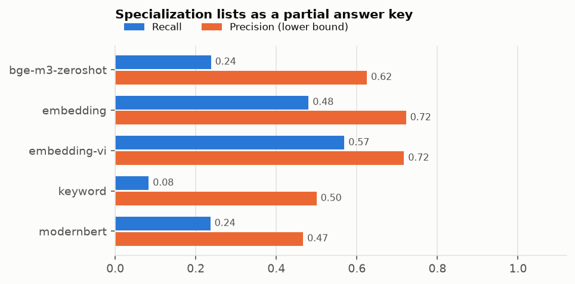
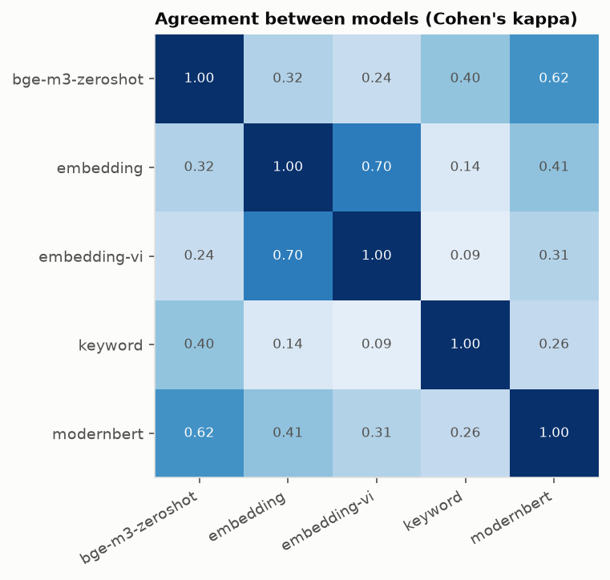
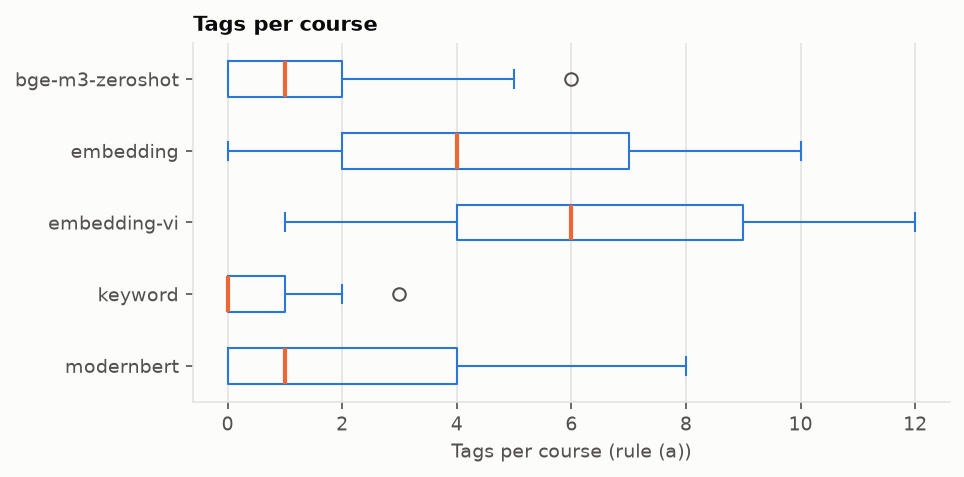
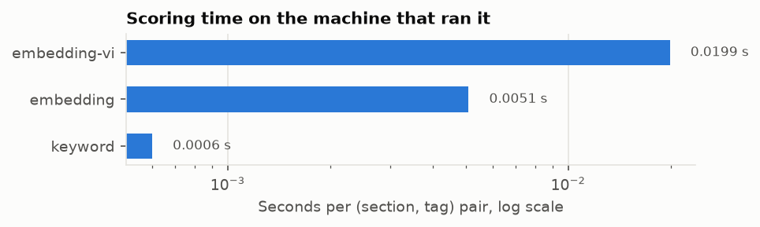

# Evaluation: MCE-CDT

29 courses scored, models: bge-m3-zeroshot, embedding, embedding-vi, keyword, modernbert. No human labels: every number below comes from the faculty's own course lists or from comparing scorers with each other.

## Specialization recall

Each specialization's course list (written by the faculty) is a partial answer key. Recall = share of listed courses that got the specialization tag. Precision is a lower bound: a course outside the list may still deserve the tag.

| Model | Recall | Precision (lb) | KTCDT | ROB | ROBOT |
|---|---|---|---|---|---|
| bge-m3-zeroshot | 0.24 | 0.62 | 0.00 | 0.50 | 0.21 |
| embedding | 0.48 | 0.72 | 0.33 | 0.75 | 0.36 |
| embedding-vi | 0.57 | 0.72 | 0.60 | 0.75 | 0.36 |
| keyword | 0.08 | 0.50 | 0.00 | 0.25 | 0.00 |
| modernbert | 0.24 | 0.47 | 0.07 | 0.50 | 0.14 |

## Agreement between models

| Pair | Cohen's kappa |
|---|---|
| bge-m3-zeroshot vs embedding | 0.32 |
| bge-m3-zeroshot vs embedding-vi | 0.24 |
| bge-m3-zeroshot vs keyword | 0.40 |
| bge-m3-zeroshot vs modernbert | 0.62 |
| embedding vs embedding-vi | 0.70 |
| embedding vs keyword | 0.14 |
| embedding vs modernbert | 0.41 |
| embedding-vi vs keyword | 0.09 |
| embedding-vi vs modernbert | 0.31 |
| keyword vs modernbert | 0.26 |

Krippendorff's alpha per tag across models: mean 0.27; 2 of 24 tags reach 0.667 (tags every model left out of every course have no defined alpha).

## Section consistency

Tags from the summary alone vs tags from the other sections (Jaccard, 1 = same tags). Low agreement flags syllabi whose sections disagree; copied summaries (the provider's error) are counted apart.

| Model | Jaccard | Courses | Copied summaries: Jaccard | Courses |
|---|---|---|---|---|
| bge-m3-zeroshot | 0.52 | 29 | – | 0 |
| embedding | 0.49 | 29 | – | 0 |
| embedding-vi | 0.56 | 29 | – | 0 |
| keyword | 0.69 | 29 | – | 0 |
| modernbert | 0.63 | 29 | – | 0 |

## Language stability

| Same scorer, English vs Vietnamese text | Jaccard of course tags |
|---|---|
| embedding vs embedding-vi | 0.61 |

## Tags per course

| Model | Mean | Median | Courses with no tag | Max |
|---|---|---|---|---|
| bge-m3-zeroshot | 1.2 | 1 | 13 | 6 |
| embedding | 4.4 | 4 | 1 | 10 |
| embedding-vi | 6.1 | 6 | 0 | 12 |
| keyword | 0.4 | 0 | 21 | 3 |
| modernbert | 2.0 | 1 | 14 | 8 |

## Run time

| Model | Pairs | Scored this run | Seconds | Seconds per pair |
|---|---|---|---|---|
| bge-m3-zeroshot | 2784 | 0 | 0.0 | – |
| embedding | 2784 | 2452 | 12.5 | 0.005 |
| embedding-vi | 2784 | 2356 | 46.8 | 0.020 |
| keyword | 2784 | 2452 | 1.4 | 0.001 |
| modernbert | 2784 | 0 | 0.0 | – |

Times are from the machine that ran `classify` (this laptop's CPU unless noted); pairs already in the cache cost nothing and are not timed.
