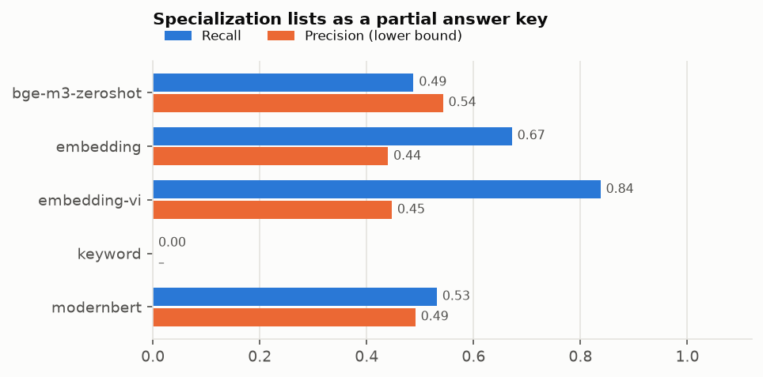
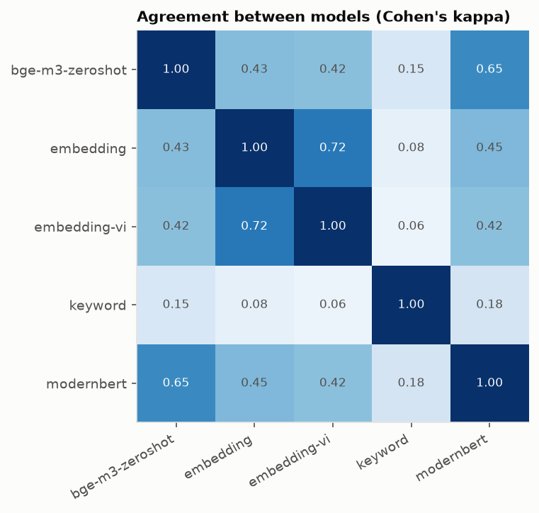
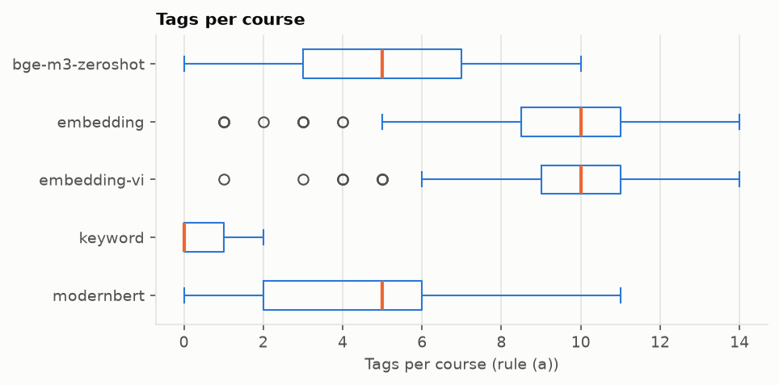
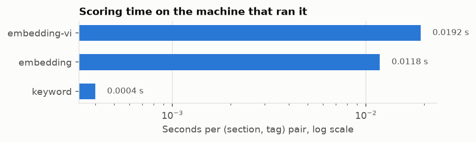

# Evaluation: MSE-KTVL

87 courses scored, models: bge-m3-zeroshot, embedding, embedding-vi, keyword, modernbert. No human labels: every number below comes from the faculty's own course lists or from comparing scorers with each other.

## Specialization recall

Each specialization's course list (written by the faculty) is a partial answer key. Recall = share of listed courses that got the specialization tag. Precision is a lower bound: a course outside the list may still deserve the tag.

| Model | Recall | Precision (lb) | KTVL | POLYME | SLCAT | VLKL | VLNL |
|---|---|---|---|---|---|---|---|
| bge-m3-zeroshot | 0.49 | 0.54 | 0.22 | 0.83 | 0.18 | 0.78 | 0.43 |
| embedding | 0.67 | 0.44 | 0.89 | 1.00 | 0.47 | 0.50 | 0.50 |
| embedding-vi | 0.84 | 0.45 | 1.00 | 1.00 | 0.53 | 0.94 | 0.71 |
| keyword | 0.00 | – | 0.00 | 0.00 | 0.00 | 0.00 | 0.00 |
| modernbert | 0.53 | 0.49 | 0.89 | 0.33 | 0.12 | 0.89 | 0.43 |

## Agreement between models

| Pair | Cohen's kappa |
|---|---|
| bge-m3-zeroshot vs embedding | 0.43 |
| bge-m3-zeroshot vs embedding-vi | 0.42 |
| bge-m3-zeroshot vs keyword | 0.15 |
| bge-m3-zeroshot vs modernbert | 0.65 |
| embedding vs embedding-vi | 0.72 |
| embedding vs keyword | 0.08 |
| embedding vs modernbert | 0.45 |
| embedding-vi vs keyword | 0.06 |
| embedding-vi vs modernbert | 0.42 |
| keyword vs modernbert | 0.18 |

Krippendorff's alpha per tag across models: mean 0.29; 4 of 58 tags reach 0.667 (tags every model left out of every course have no defined alpha).

## Section consistency

Tags from the summary alone vs tags from the other sections (Jaccard, 1 = same tags). Low agreement flags syllabi whose sections disagree; copied summaries (the provider's error) are counted apart.

| Model | Jaccard | Courses | Copied summaries: Jaccard | Courses |
|---|---|---|---|---|
| bge-m3-zeroshot | 0.52 | 86 | – | 0 |
| embedding | 0.53 | 86 | – | 0 |
| embedding-vi | 0.60 | 86 | – | 0 |
| keyword | 0.59 | 86 | – | 0 |
| modernbert | 0.51 | 86 | – | 0 |

## Language stability

| Same scorer, English vs Vietnamese text | Jaccard of course tags |
|---|---|
| embedding vs embedding-vi | 0.62 |

## Tags per course

| Model | Mean | Median | Courses with no tag | Max |
|---|---|---|---|---|
| bge-m3-zeroshot | 4.7 | 5 | 7 | 10 |
| embedding | 9.1 | 10 | 0 | 14 |
| embedding-vi | 9.7 | 10 | 0 | 14 |
| keyword | 0.6 | 0 | 44 | 2 |
| modernbert | 4.6 | 5 | 9 | 11 |

## Run time

| Model | Pairs | Scored this run | Seconds | Seconds per pair |
|---|---|---|---|---|
| bge-m3-zeroshot | 20820 | 0 | 0.0 | – |
| embedding | 20820 | 20600 | 243.2 | 0.012 |
| embedding-vi | 20820 | 20496 | 392.9 | 0.019 |
| keyword | 20068 | 19848 | 8.4 | 0.000 |
| modernbert | 20068 | 0 | 0.0 | – |

Times are from the machine that ran `classify` (this laptop's CPU unless noted); pairs already in the cache cost nothing and are not timed.
