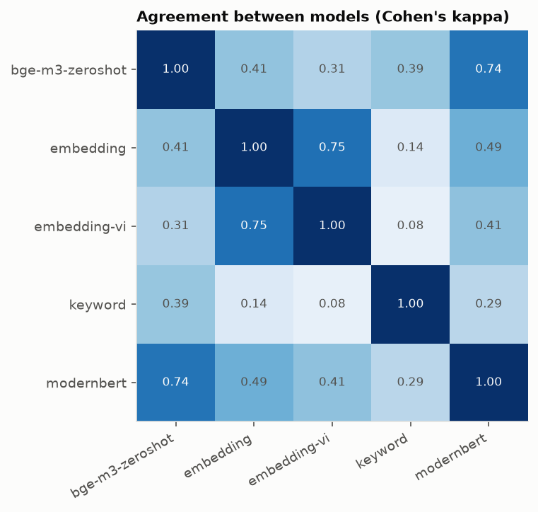
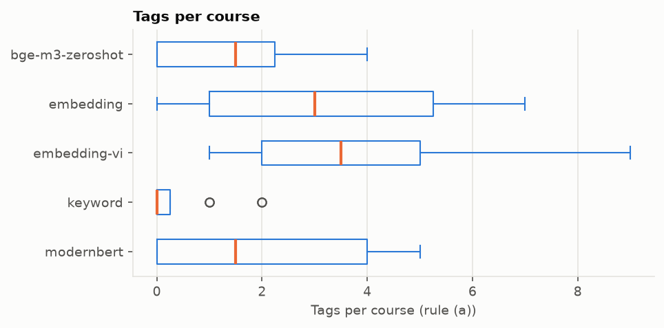
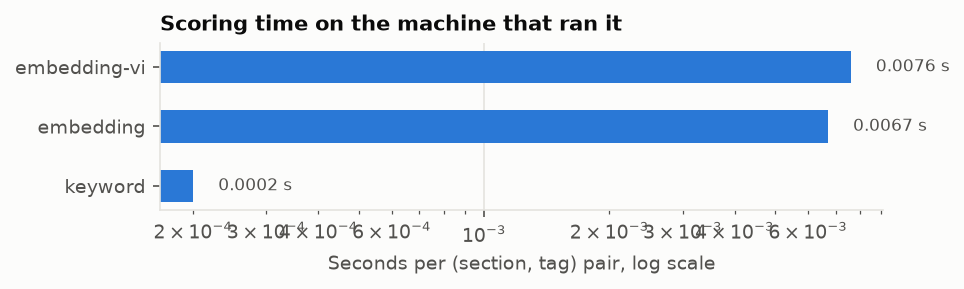

# Evaluation: NAE-KTTT

16 courses scored, models: bge-m3-zeroshot, embedding, embedding-vi, keyword, modernbert. No human labels: every number below comes from the faculty's own course lists or from comparing scorers with each other.

## Specialization recall

Each specialization's course list (written by the faculty) is a partial answer key. Recall = share of listed courses that got the specialization tag. Precision is a lower bound: a course outside the list may still deserve the tag.

| Model | Recall | Precision (lb) |
|---|---|---|
| bge-m3-zeroshot | – | – |
| embedding | – | – |
| embedding-vi | – | – |
| keyword | – | – |
| modernbert | – | – |

## Agreement between models

| Pair | Cohen's kappa |
|---|---|
| bge-m3-zeroshot vs embedding | 0.41 |
| bge-m3-zeroshot vs embedding-vi | 0.31 |
| bge-m3-zeroshot vs keyword | 0.39 |
| bge-m3-zeroshot vs modernbert | 0.74 |
| embedding vs embedding-vi | 0.75 |
| embedding vs keyword | 0.14 |
| embedding vs modernbert | 0.49 |
| embedding-vi vs keyword | 0.08 |
| embedding-vi vs modernbert | 0.41 |
| keyword vs modernbert | 0.29 |

Krippendorff's alpha per tag across models: mean 0.31; 1 of 15 tags reach 0.667 (tags every model left out of every course have no defined alpha).

## Section consistency

Tags from the summary alone vs tags from the other sections (Jaccard, 1 = same tags). Low agreement flags syllabi whose sections disagree; copied summaries (the provider's error) are counted apart.

| Model | Jaccard | Courses | Copied summaries: Jaccard | Courses |
|---|---|---|---|---|
| bge-m3-zeroshot | 0.67 | 16 | – | 0 |
| embedding | 0.52 | 16 | – | 0 |
| embedding-vi | 0.47 | 16 | – | 0 |
| keyword | 0.66 | 16 | – | 0 |
| modernbert | 0.49 | 16 | – | 0 |

## Language stability

| Same scorer, English vs Vietnamese text | Jaccard of course tags |
|---|---|
| embedding vs embedding-vi | 0.62 |

## Tags per course

| Model | Mean | Median | Courses with no tag | Max |
|---|---|---|---|---|
| bge-m3-zeroshot | 1.4 | 1 | 7 | 4 |
| embedding | 3.2 | 3 | 1 | 7 |
| embedding-vi | 3.9 | 3 | 0 | 9 |
| keyword | 0.4 | 0 | 12 | 2 |
| modernbert | 2.0 | 1 | 5 | 5 |

## Run time

| Model | Pairs | Scored this run | Seconds | Seconds per pair |
|---|---|---|---|---|
| bge-m3-zeroshot | 1024 | 0 | 0.0 | – |
| embedding | 1024 | 736 | 5.0 | 0.007 |
| embedding-vi | 1024 | 668 | 5.1 | 0.008 |
| keyword | 1024 | 736 | 0.2 | 0.000 |
| modernbert | 1024 | 0 | 0.0 | – |

Times are from the machine that ran `classify` (this laptop's CPU unless noted); pairs already in the cache cost nothing and are not timed.
