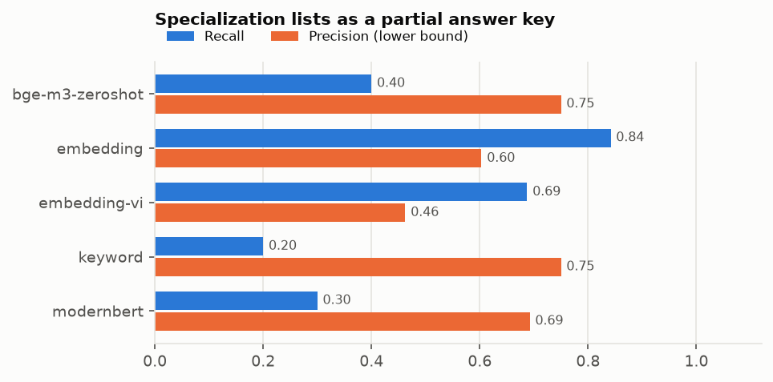
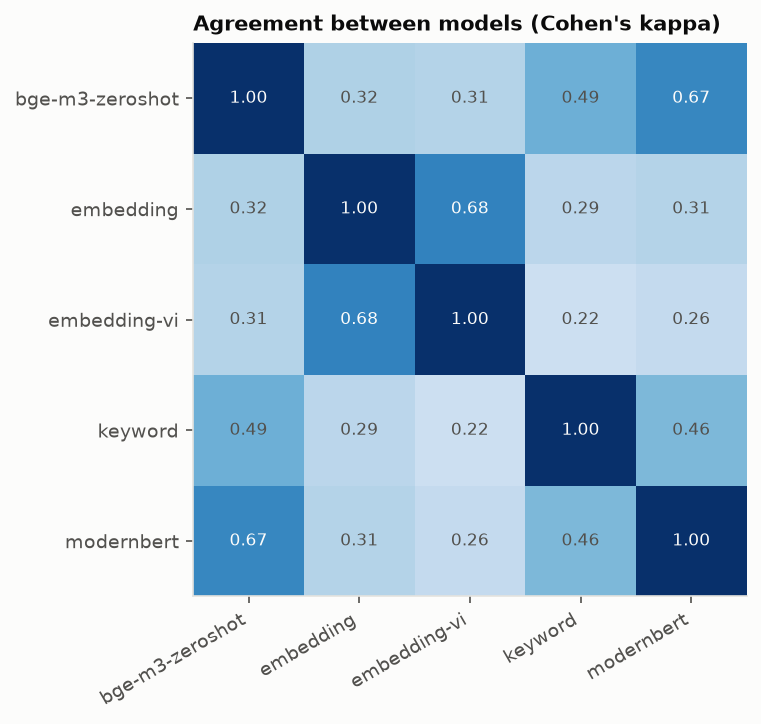
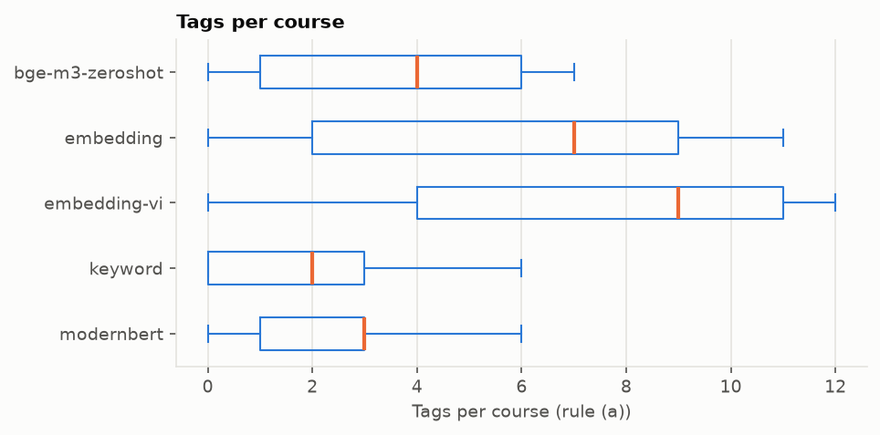
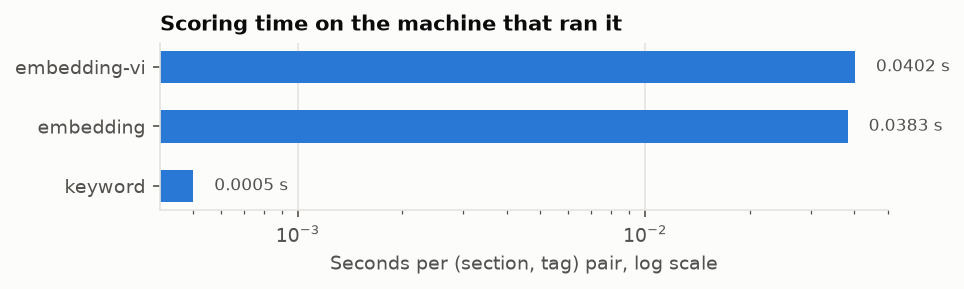

# Evaluation: NR-QLTNMT

33 courses scored, models: bge-m3-zeroshot, embedding, embedding-vi, keyword, modernbert. No human labels: every number below comes from the faculty's own course lists or from comparing scorers with each other.

## Specialization recall

Each specialization's course list (written by the faculty) is a partial answer key. Recall = share of listed courses that got the specialization tag. Precision is a lower bound: a course outside the list may still deserve the tag.

| Model | Recall | Precision (lb) | MTATSK | TNMT |
|---|---|---|---|---|
| bge-m3-zeroshot | 0.40 | 0.75 | 0.00 | 0.80 |
| embedding | 0.84 | 0.60 | 0.75 | 0.93 |
| embedding-vi | 0.69 | 0.46 | 0.38 | 1.00 |
| keyword | 0.20 | 0.75 | 0.00 | 0.40 |
| modernbert | 0.30 | 0.69 | 0.00 | 0.60 |

## Agreement between models

| Pair | Cohen's kappa |
|---|---|
| bge-m3-zeroshot vs embedding | 0.32 |
| bge-m3-zeroshot vs embedding-vi | 0.31 |
| bge-m3-zeroshot vs keyword | 0.49 |
| bge-m3-zeroshot vs modernbert | 0.67 |
| embedding vs embedding-vi | 0.68 |
| embedding vs keyword | 0.29 |
| embedding vs modernbert | 0.31 |
| embedding-vi vs keyword | 0.22 |
| embedding-vi vs modernbert | 0.26 |
| keyword vs modernbert | 0.46 |

Krippendorff's alpha per tag across models: mean 0.23; 2 of 28 tags reach 0.667 (tags every model left out of every course have no defined alpha).

## Section consistency

Tags from the summary alone vs tags from the other sections (Jaccard, 1 = same tags). Low agreement flags syllabi whose sections disagree; copied summaries (the provider's error) are counted apart.

| Model | Jaccard | Courses | Copied summaries: Jaccard | Courses |
|---|---|---|---|---|
| bge-m3-zeroshot | 0.50 | 32 | 0.00 | 1 |
| embedding | 0.53 | 32 | 0.40 | 1 |
| embedding-vi | 0.48 | 32 | 0.43 | 1 |
| keyword | 0.48 | 30 | 1.00 | 1 |
| modernbert | 0.58 | 30 | 0.00 | 1 |

## Language stability

| Same scorer, English vs Vietnamese text | Jaccard of course tags |
|---|---|
| embedding vs embedding-vi | 0.59 |

## Tags per course

| Model | Mean | Median | Courses with no tag | Max |
|---|---|---|---|---|
| bge-m3-zeroshot | 3.4 | 4 | 7 | 7 |
| embedding | 5.4 | 7 | 4 | 11 |
| embedding-vi | 7.6 | 9 | 1 | 12 |
| keyword | 1.9 | 2 | 11 | 6 |
| modernbert | 2.5 | 3 | 6 | 6 |

## Run time

| Model | Pairs | Scored this run | Seconds | Seconds per pair |
|---|---|---|---|---|
| bge-m3-zeroshot | 3960 | 0 | 0.0 | – |
| embedding | 3960 | 3386 | 129.5 | 0.038 |
| embedding-vi | 3960 | 3240 | 130.3 | 0.040 |
| keyword | 3683 | 3278 | 1.8 | 0.001 |
| modernbert | 3683 | 0 | 0.0 | – |

Times are from the machine that ran `classify` (this laptop's CPU unless noted); pairs already in the cache cost nothing and are not timed.
